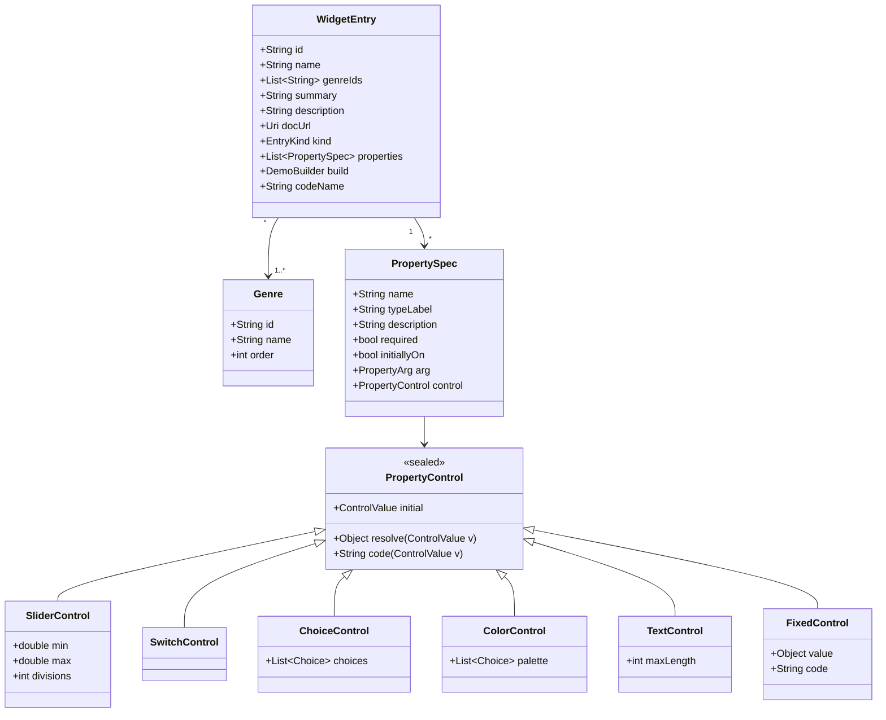
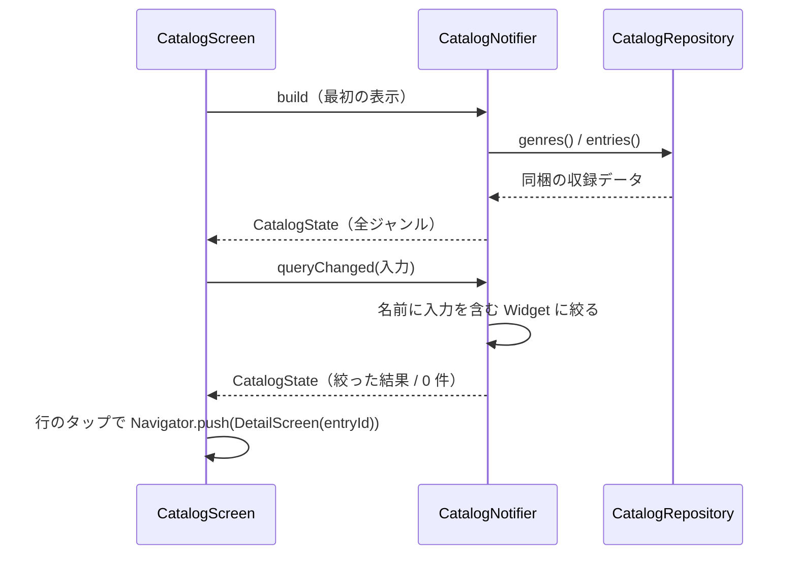
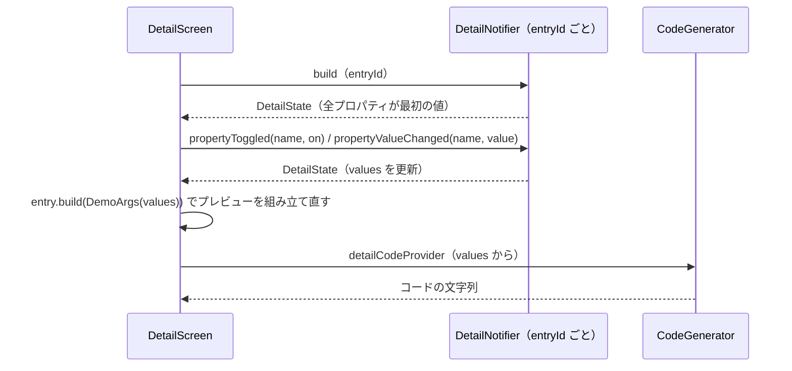
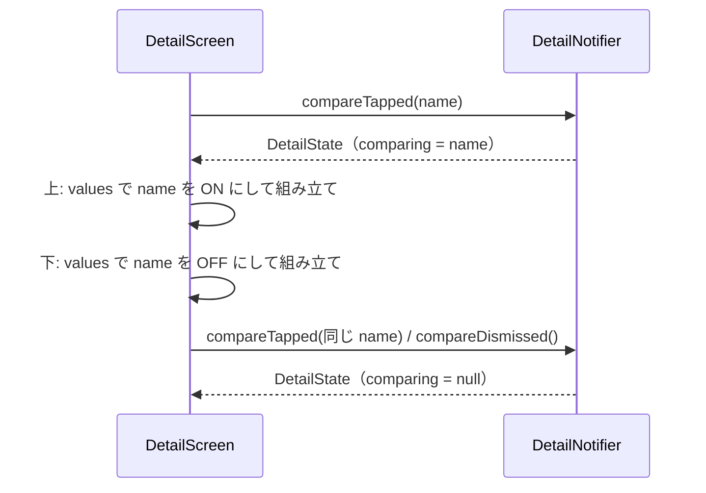
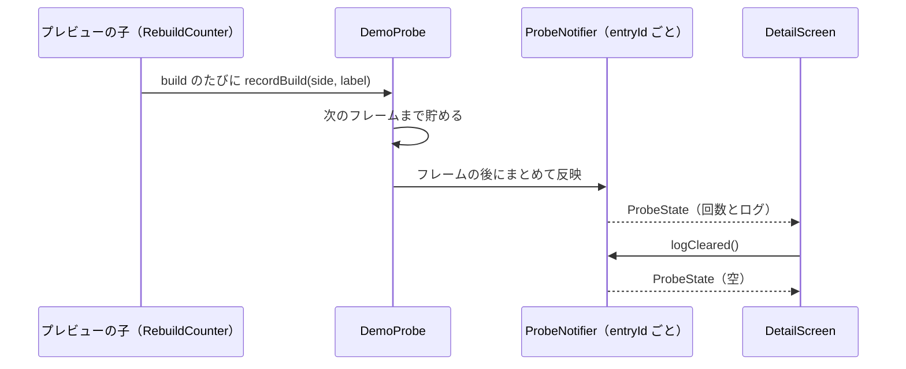
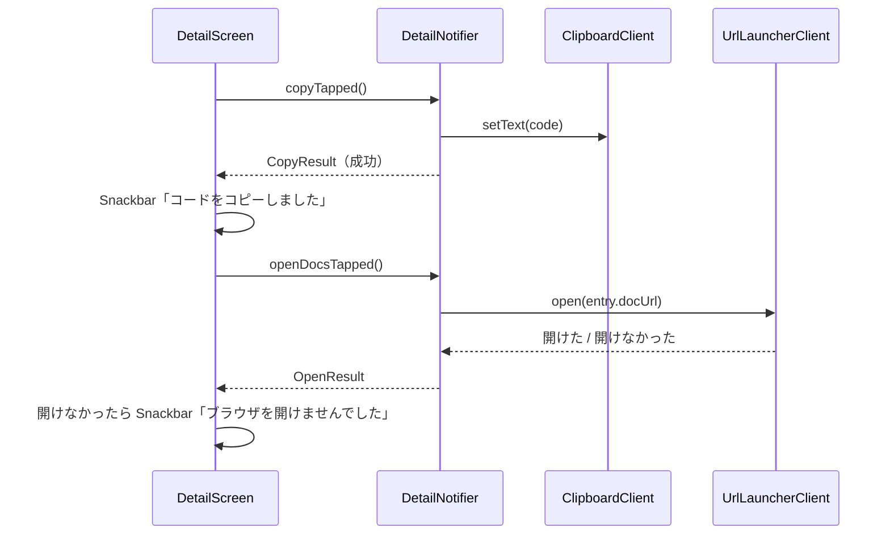

# 機能設計: デモの組み立て（収録データ・プレイグラウンド・比較・コード・可視化）

> **要約**
> - 結論: Widget 1つを「プロパティの定義の一覧＋組み立ての関数」のデータ（`WidgetEntry`）で表し、操作パネル・プレビュー・比較・コードを全部そこから作る
> - 影響: 一覧画面（ca_lst）と詳細画面（cb_dtl）のすべて。Widget を1つ足すときは `lib/catalog/<ジャンル>/` に1ファイル足すだけにする
> - お願い: 「収録データの型」と「状態と依存」の節の確認。この型を ADR-0002 に残すかの判断

## 概要

PRD の「デモの組み立て」の要件（プロパティの定義のデータから組み立て、1つ足す手間を小さくする）を満たす仕組み。起動時に同梱の収録データを読み、一覧画面はそれを並べ、詳細画面はその1件からプレビュー・操作パネル・比較・コードを作る。通信も保存もしない。

## 種別と条件

| 種別 | 発生する条件 | 利用者に見えること |
|---|---|---|
| 見た目を持つ Widget（`visual`） | 収録データの `kind` が `visual` | プレビューに Widget の見た目。比較は「付けた／付けない」 |
| 見た目を持たない Widget（`behavior`） | 収録データの `kind` が `behavior`（`InheritedWidget`・`Builder` など） | プレビューにデモの木と再ビルドの回数、操作タブにログ。比較は「使った／使わない」 |

## 収録データの型

`lib/catalog/` に置く。どれも不変のクラス（ADR-0001 のモデル）。

- **PropertyControl** は「画面の操作部品」と「Dart の値への写し方」と「コードの書き方」を1つにまとめたもの。操作部品が扱う値（`ControlValue`: `SliderValue(double)`・`SwitchValue(bool)`・`ChoiceValue(int)`・`TextValue(String)`・`FixedValue`）は少数に絞り、`resolve` で Widget に渡す値（例: `16.0` → `EdgeInsets.all(16)`）に、`code` でコードの文字列（`EdgeInsets.all(16.0)`）に写す
  - 例: `padding` は `SliderControl(min: 0, max: 48, divisions: 12, resolve: EdgeInsets.all, code: 'EdgeInsets.all($v)')`
  - 例: `mainAxisAlignment` は `ChoiceControl([Choice('start', MainAxisAlignment.start, 'MainAxisAlignment.start'), …])`
  - `ChoiceControl` は 4 つまでなら `SegmentedButton`、5 つ以上なら `DropdownMenu` で出す（ui-spec の op-valu）
  - `FixedControl` は `child` のように利用者が変えない値（例: デモの子 `FlutterLogo()`）。操作パネルでは ON/OFF だけを出す
- **PropertyArg** はコードでの書き方: `named`（`padding: …`）か `positional`（`Text('こんにちは')` の最初の引数）
- **required** のプロパティは常に ON（スイッチを出さず「必須」の印）。`initiallyOn` は開いたときの ON/OFF
- **DemoBuilder** は `Widget Function(DemoArgs args)`。`DemoArgs` は ON のプロパティだけ値を返す（`args.valueOf<EdgeInsets>('padding')` は OFF なら `null`）。組み立ての関数は、`null` のときに Widget の既定値を渡す（Dart では引数を条件つきで省けないため。既定値は公式の API ドキュメントの値に合わせ、テストで全部 OFF の組み立てが落ちないことを確かめる）
- `behavior` の Widget の組み立ての関数は、`DemoArgs.probe`（`DemoProbe`）を受け取り、子を `RebuildCounter(label: 'Counter', probe: …)` で包んで再ビルドを数え、`probe.log('…')` でログを出す

置き場所:

| ファイル | 中身 |
|---|---|
| `lib/catalog/model/*.dart` | 上の型 |
| `lib/catalog/genres.dart` | 公式カタログのジャンルと順番 |
| `lib/catalog/<ジャンル>/<widget>.dart` | 1 Widget = 1 ファイル（`final paddingEntry = WidgetEntry(…)`） |
| `lib/catalog/catalog.dart` | 全件の一覧（`const allEntries = [...]`） |
| `lib/catalog/manifest.dart` | 公式カタログに載る Widget 名の一覧（ジャンルごと）。収録の進み具合と抜けを確かめるためのもの |

## 処理の流れ

### 1. 一覧を開く・検索する

### 2. 詳細でプロパティを変える

### 3. 比べる

「付けた」側は、そのプロパティが今 OFF でも、覚えている値（なければ `control.initial`）で ON にする。比べるプロパティ以外の値は 2 枚とも同じ。

### 4. 見た目を持たない Widget の可視化

build の最中に Provider を書き換えると Riverpod が例外を出すので、`DemoProbe` が回数とログを貯めて、`addPostFrameCallback` でまとめて ProbeNotifier に渡す。回数の表示（pv-rbld）とログ（op-logs）は ProbeNotifier を見る。比較中は `side`（`with` / `without`）で分けて数える。

### 5. コピー・公式ドキュメントを開く

Snackbar は一度だけ出す知らせなので State に持たず、メソッドの結果を View が受けて出す（docs/architecture.md の遷移と同じ考え方）。

## 状態と依存

| Provider | 種類 | 持つもの | 寿命 |
|---|---|---|---|
| `catalogRepositoryProvider` | Provider（`keepAlive`） | `CatalogRepository`（同梱データを返す。同期） | アプリの間ずっと |
| `catalogNotifierProvider` | Notifier | `CatalogState` | 一覧画面の間 |
| `detailNotifierProvider(entryId)` | Notifier（family・autoDispose） | `DetailState` | 詳細画面の間。戻ると捨てる（cb_dtl の確認・調整事項 1） |
| `detailCodeProvider(entryId)` | Provider（family・autoDispose） | コードの文字列（`DetailState` から作る） | 同上 |
| `probeNotifierProvider(entryId)` | Notifier（family・autoDispose） | `ProbeState` | 同上 |
| `clipboardClientProvider`・`urlLauncherClientProvider` | Provider | OS の機能の薄い包み（テストで差し替える） | アプリの間ずっと |

### CatalogState

| プロパティ | 型 | 初期値 | 内容 |
|---|---|---|---|
| `query` | `String` | `''` | 検索の入力（前後の空白を除いたもの） |
| `sections` | `List<CatalogSection>` | 全ジャンル | ジャンルと、その中の Widget（絞った結果）。0 件のジャンルは入れない |

`isEmpty`（`query` があり `sections` が空）は State から求める。読み込み中・エラーは同梱データなので持たない。

検索の入力は ①（画面の中だけの一時的な状態）に近いが、絞った結果をチップ・見出し・行・空状態の4か所で使い、絞り込みはロジックなので Notifier に置く（coding-convention の例外。入力のたびに渡す。件数が数百なので、1文字ごとに絞り直しても待ちは出ない）。

### DetailState

| プロパティ | 型 | 初期値 | 内容 |
|---|---|---|---|
| `entry` | `WidgetEntry` | 受け取った ID の収録データ | |
| `settings` | `Map<String, PropertySetting>` | 各プロパティの `initiallyOn` と `control.initial` | `PropertySetting(on: bool, value: ControlValue)`。OFF にしても `value` は覚えておく |
| `comparing` | `String?` | `null` | 比べているプロパティの名前。`null` は比較していない |

`isModified`（最初の値から1つでも変わった、または比較中）は State から求める（ab-rset の活性）。

### ProbeState

| プロパティ | 型 | 初期値 | 内容 |
|---|---|---|---|
| `counts` | `Map<ProbeKey, int>` | 空 | `ProbeKey(side, label)` ごとの再ビルドの回数 |
| `logs` | `List<String>` | 空 | 新しい順、最大 50 件 |

## イベント

| 画面 | メソッド | 分類 | 状態の変化 |
|---|---|---|---|
| ca_lst | `queryChanged(String)` | ユーザー | `query` と `sections` を更新 |
| ca_lst | `queryCleared()` | ユーザー | `query` を空、`sections` を全件 |
| cb_dtl | `propertyToggled(String name, bool on)` | ユーザー | `settings[name].on`。required は変えない |
| cb_dtl | `propertyValueChanged(String name, ControlValue value)` | ユーザー | `settings[name].value`。OFF のときは呼ばれない（View で非活性） |
| cb_dtl | `compareTapped(String name)` | ユーザー | `comparing` が `name` なら `null`、それ以外なら `name` |
| cb_dtl | `compareDismissed()` | ユーザー | `comparing = null` |
| cb_dtl | `resetTapped()` | ユーザー | `settings` を最初の値、`comparing = null`。ProbeState も空にする |
| cb_dtl | `copyTapped()` → `Future<bool>` | ユーザー＋副作用の結果 | 変化なし。成功したかを返す |
| cb_dtl | `openDocsTapped()` → `Future<bool>` | ユーザー＋副作用の結果 | 変化なし。開けたかを返す |
| cb_dtl | `ProbeNotifier.recorded(List<ProbeEvent>)` | 副作用の結果 | `counts` と `logs` を更新 |
| cb_dtl | `ProbeNotifier.logCleared()` | ユーザー | `counts` と `logs` を空 |

## 共通の処理と状態

- 保存するもの: なし（詳細の設定は画面を離れると捨てる）
- 送るもの: なし。外へ出るのは「公式ドキュメントを開く」の URL だけ

## コード生成

`CodeGenerator.generate(entry, settings)` は純粋な関数（`lib/features/detail/view_model/`）。

1. `entry.codeName`（例: `Padding`）を書き、`(` を開く
2. `positional` のプロパティ（ON のもの）を先に、`named` のプロパティ（ON のもの・required）を収録データの順に、`name: control.code(value),` の形で1行ずつ書く（字下げは2文字）
3. `)` で閉じる。プロパティが1つもなければ `Padding()` のように1行にする
4. 値の文字列は `control.code` に任せる（`Color(0xFF1E50A2)`・`'こんにちは'` のように、そのまま貼れる Dart の式にする）

## エラーと例外

| 起きること | 利用者への見せ方 | リトライ | ログ |
|---|---|---|---|
| 公式ドキュメントを開けない（ブラウザがない・URL を扱えない） | Snackbar「ブラウザを開けませんでした」 | 利用者がもう一度押す | なし |
| クリップボードに書けない | Snackbar「コピーできませんでした」 | 利用者がもう一度押す | なし |
| 組み立ての関数が例外を出す（収録データの不備） | プレビューのカードに Flutter の標準のエラー表示（debug）。release では空のカード | なし | なし。全件の組み立てをテストで確かめて防ぐ |
| 一覧から渡された ID の収録データがない | 起きない（一覧は同じ収録データから作る）。万一のときは一覧へ戻す | なし | なし |

「コピーできませんでした」は ui-spec の文言の表にないため、cb_dtl の文言に足す。

## 外部 SDK・API の扱い

| 相手 | この処理でしていること | 失敗したとき |
|---|---|---|
| url_launcher（`launchUrl`、外部のブラウザ） | 公式の API ドキュメントを開く | `false` を返し、Snackbar |
| Flutter の `Clipboard.setData` | コードをコピー | 例外を捕まえて `false`、Snackbar |

## テストの観点

- 収録データ: 全件の組み立てが、全部 OFF・全部 ON（required は常に ON）・各 Choice のどれでも例外を出さない
- 収録データ: ID が重ならない。全件が1つ以上のジャンルに入っている。ジャンルの ID が `genres.dart` にある
- 収録データ: `manifest.dart` にない Widget を収録していない。収録の抜けを数える（全部揃うまでは数を出すだけ。揃ったら全件を求めるテストにする）
- 検索: 部分一致・大文字小文字の区別なし・前後の空白の無視・0 件
- DetailNotifier: ON/OFF、値の変更、OFF にしても値を覚えている、required は OFF にできない、比較の開始・切り替え・やめる、初期状態に戻す
- 比較: 「付けた」側は OFF のプロパティでも覚えている値で組み立てる
- コード生成: ON だけを書く、positional が先、プロパティなし、値の式（数値・enum・色・文字）
- 可視化: build の中で回数を数えても例外が出ない（フレームの後に反映）。ログは最大 50 件。ログを消すと回数も 0
- コピー・リンク: 成功・失敗で Snackbar の文言が変わる（Client を fake に）
- 画面を離れると DetailState と ProbeState が捨てられる（autoDispose）
