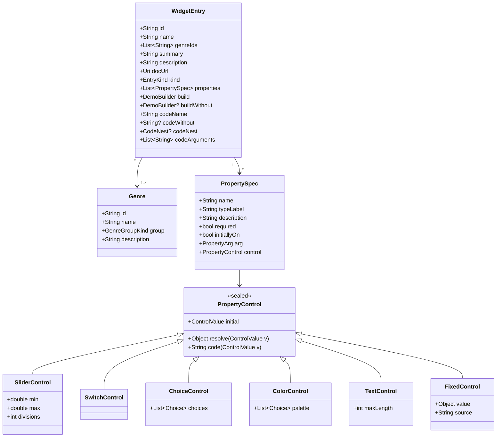
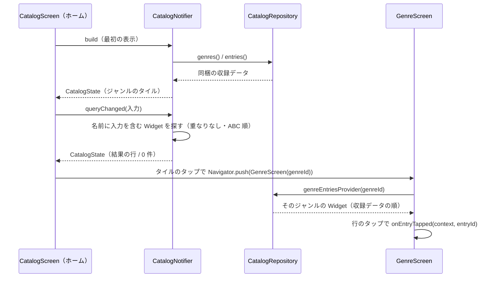
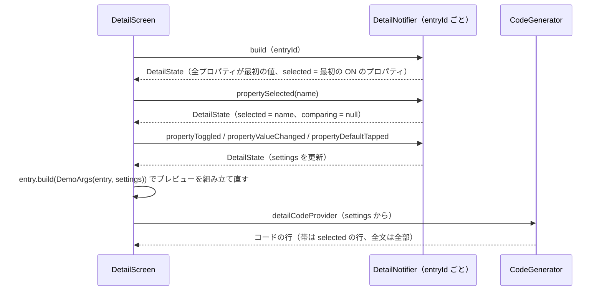
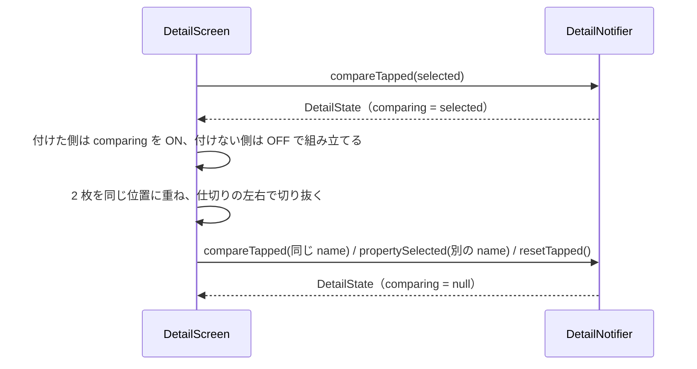
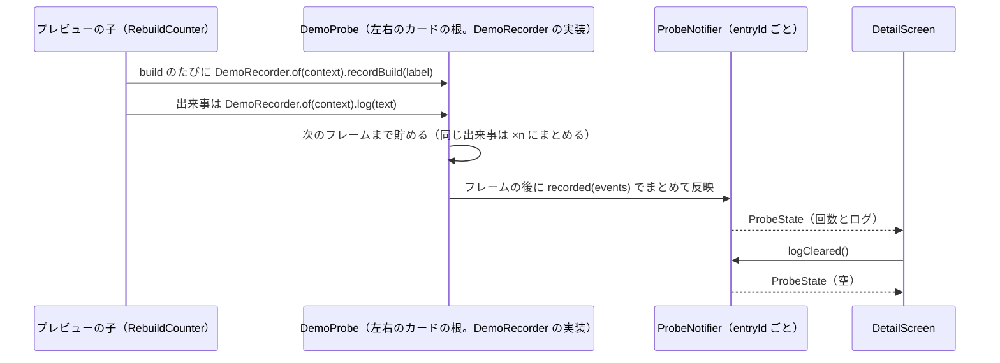
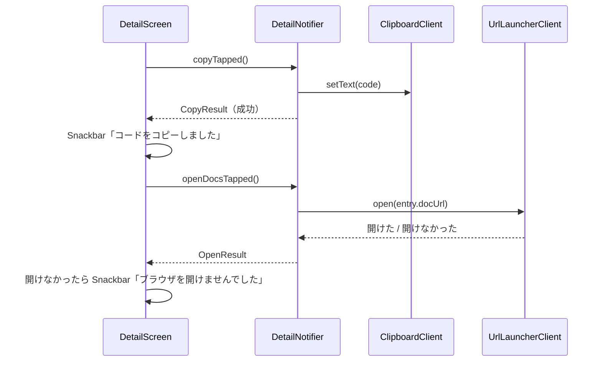

# 機能設計: デモの組み立て（収録データ・プレイグラウンド・比較・コード・可視化）

> **要約**
> - 結論: Widget 1つを「プロパティの定義の一覧＋組み立ての関数」のデータ（`WidgetEntry`）で表し、操作パネル・プレビュー・比較・コードを全部そこから作る
> - 影響: ホーム画面（ca_lst）・ジャンル画面（cc_gnr）・詳細画面（cb_dtl）のすべて。Widget を1つ足すときは `lib/catalog/<ジャンル>/` に1ファイル足すだけにする
> - お願い: 「収録データの型」と「状態と依存」の節の確認。この型を ADR-0002 に残すかの判断

## 概要

PRD の「デモの組み立て」の要件（プロパティの定義のデータから組み立て、1つ足す手間を小さくする）を満たす仕組み。起動時に同梱の収録データを読み、ホーム画面はジャンルのタイルと検索の結果を、ジャンル画面はそのジャンルの見本つきの行を並べ、詳細画面はその1件からプレビュー・チップ・編集パネル・比較・コードを作る。通信も保存もしない。

## 種別と条件

| 種別 | 発生する条件 | 利用者に見えること |
|---|---|---|
| 見た目を持つ Widget（`visual`） | 収録データの `kind` が `visual` | プレビューに Widget の見た目。比較は「付けた／付けない」 |
| 見た目を持たない Widget（`behavior`） | 収録データの `kind` が `behavior`（`MediaQuery`・`StreamBuilder`・`NotificationListener` など） | プレビューにデモの木と子ごとの build の回数、コードの帯の下にログの帯（全件はシート）。比較はプロパティではなく Widget そのものを「使った／使わない」 |

## 収録データの型

`lib/catalog/` に置く。どれも不変のクラス（ADR-0001 のモデル）。

- **PropertyControl** は「画面の操作部品」と「Dart の値への写し方」と「コードの書き方」を1つにまとめたもの。操作部品が扱う値（`ControlValue`: `SliderValue(double)`・`SwitchValue(bool)`・`ChoiceValue(int)`・`TextValue(String)`・`FixedValue`）は少数に絞り、`resolve` で Widget に渡す値（例: `16.0` → `EdgeInsets.all(16)`）に、`code` でコードの文字列（`EdgeInsets.all(16.0)`）に写す
  - 例: `padding` は `SliderControl(min: 0, max: 48, divisions: 12, resolve: EdgeInsets.all, code: 'EdgeInsets.all($v)')`
  - 例: `mainAxisAlignment` は `ChoiceControl([Choice('start', MainAxisAlignment.start, 'MainAxisAlignment.start'), …])`
  - `ChoiceControl` は 4 つまでなら `SegmentedButton`、5 つ以上なら `DropdownMenu` で出す（ui-spec の op-valu）
  - `FixedControl` は `child` のように利用者が変えない値（例: デモの子 `FlutterLogo()`）。操作パネルでは ON/OFF だけを出す。コードでの書き方は `source`（メソッドの `code` と名前が重なるため）
  - 開いたときの値は、操作部品ごとに `initialValue`（スライダー・スイッチ・文字）か `initialIndex`（選択肢・色見本）で書き、`initial` で `ControlValue` として読む
  - スライダーの値は、Slider が段ごとに返す値（`min + (max - min) * i / divisions`）の浮動小数の誤差を小数第 6 位で丸めてから写す（例: 109.99999999999999 → `110.0`）
  - 色見本は `Choice.color('瑠璃', Color(…))` で書く（コードは `colorCode` が `Color(0xFF1E50A2)` にする）。文字のコードは `dartString` が一重引用符で囲み、`\`・`'`・`$`・改行を逃がす（どちらも `lib/catalog/model/dart_code.dart`）
  - 操作部品と合わない種類の値（例: スイッチに `SliderValue`）は `ArgumentError`
- **PropertyArg** はコードでの書き方: `named`（`padding: …`）・`positional`（`Text('こんにちは')` の最初の引数）・`nested`（`WidgetEntry.codeNest` の入れ子の式の中）・`typeArgument`（`NotificationListener<…>` の型引数。必須にし、1 Widget に 1 つまで。全件のテストで確かめる。Dart では型引数を値から作れないので、選択肢の値はその型で組み立てる関数にする（例: `_listener<ScrollUpdateNotification>`））
- **required** のプロパティは常に ON（スイッチを出さず「必須」の印）。`initiallyOn` は開いたときの ON/OFF
- **PropertySetting**（`on`・`value`）も `lib/catalog/model/` に置く（DemoArgs・CodeGenerator・DetailState が使う）。`WidgetEntry.initialSettings()` が開いたときの設定を、`PropertySpec.isOnIn(settings)`・`valueIn(settings)` が「必須なら常に ON」「設定がなければ OFF・最初の値」を返す
- **DemoBuilder** は `Widget Function(DemoArgs args)`。`DemoArgs(entry, settings)` で作る。収録データにない名前を `valueOf` で読むと `ArgumentError`、値の型が合わないと `StateError`（収録データの不備を全件のテストで落とすため）。`DemoArgs` は ON のプロパティだけ値を返す（`args.valueOf<EdgeInsets>('padding')` は OFF なら `null`）。組み立ての関数は、`null` のときに Widget の既定値を渡す（Dart では引数を条件つきで省けないため。既定値は公式の API ドキュメントの値に合わせ、テストで全部 OFF の組み立てが落ちないことを確かめる）
- `behavior` の Widget は `buildWithout`（「使わない」側の木）を必ず持つ（全件のテストで確かめる）。既定の考え方は「包みを外す」で、中の木を返すだけの 1 行にする。包みを外すと比べる意味がなくなる Widget（builder 系）は、使わない場合のよくある書き方を手で書き、そのコードを `codeWithout` に書く（コードの全文のシートの cd-side）。`visual` の Widget は両方 `null`
- `behavior` の組み立ての関数は、数えたい子を `RebuildCounter(label: '読む子', builder: (context) => …)` で組み、出来事は `DemoRecorder.of(context).log('…')` でログに出す（「4. 見た目を持たない Widget の可視化」）。包む Widget の下の木は `const` の Widget にする（値が変わるたびに組み立ての関数が木を作り直すので、`const` でないと読んでいない子まで組み直されて数が増える）。包む範囲は `DemoScope(label: 'MediaQuery(…)', child: …)`（accent の点線と札）、使わない側の木は `DemoFit`（カードの幅に合わせ、低ければ縮める）で包む
- **CodeNest**（`name`・`receiver`・`method`。既定は `copyWith`）は、値を入れ子の式に書く Widget の書き方（例: `CodeNest(name: 'data', receiver: 'MediaQuery.of(context)')`）。**codeArguments** はチップに出さない固定の引数（例: `['child: const Readers()']`。末尾の `,` は付けない）

置き場所:

| ファイル | 中身 |
|---|---|
| `lib/catalog/model/*.dart` | 上の型 |
| `lib/catalog/genres.dart` | 公式カタログのジャンル。並びはリストの順（Cupertino・Material design のあと、基本の12ジャンルを ABC 順） |
| `lib/catalog/<ジャンル>/<widget>.dart` | 1 Widget = 1 ファイル（`final paddingEntry = WidgetEntry(…)`）。複数のジャンルに載る Widget は `genreIds` の最初のジャンルに置く |
| `lib/catalog/catalog.dart` | 全件の一覧（`final allEntries = [...]`。`docUrl` の `Uri` が const にできないため） |
| `lib/catalog/manifest.dart` | 公式カタログに載る Widget 名の一覧（ジャンルごと）。収録の進み具合と抜けを確かめるためのもの |

## 処理の流れ

### 1. ホームを開く・検索する・ジャンルを開く

### 2. 詳細でプロパティを選んで変える

### 3. 比べる

見た目を持たない Widget は `compareTapped` で `ComparingUse()` にし、左を `entry.build`、右を `entry.buildWithout` で組み立てる（設定は 2 枚とも同じ）。比較中に `propertySelected` が来ても比較をやめない。以下は見た目を持つ Widget の話。

比べる対象は編集パネルで選んでいるプロパティ。「付けた」側は、そのプロパティが今 OFF でも、覚えている値（なければ `control.initial`）で ON にする。比べるプロパティ以外の値は 2 枚とも同じ。仕切りの位置は画面の中だけの一時的な状態（StatefulWidget）。

### 4. 見た目を持たない Widget の可視化

部品は 2 か所に分ける（収録データが詳細画面に依存しないように。docs/architecture.md の依存の向き）。

| 置き場所 | 部品 |
|---|---|
| `lib/catalog/demo/` | 収録データが使うもの: 記録の窓口 `DemoRecorder`（`recordBuild`・`log`・`comparing`・`badge(label)`。アプリの文字の倍率は `DemoRecorder.textScalerOf`）と、それを木に置く `DemoRecorderScope`（倍率が変わったときだけ札と印に知らせる）、`RebuildCounter`・`DemoScope`・`DemoFit` |
| `lib/features/detail/ui/probe/` | 窓口の実装 `DemoProbe`（Riverpod につなぐ）・回数の印 `RebuildBadge`・ログの帯 `LogStrip`・ログのシート `LogSheet` |

- `DemoProbe`: 左右のカードの根に置き、自分を `DemoRecorder` として `DemoRecorderScope` に置く（`side`: `DemoSide.used` / `unused`、`comparing`）。子は `DemoRecorder.of(context)` で引く（`getInheritedWidgetOfExactType` で依存を作らないので、DemoProbe 側の変化で子が組み直されることはない）。窓口の外（見本・全件のテスト）では何もしない窓口が返る
- 貯めて後で渡す: build の最中に Provider を書き換えると Riverpod が例外を出すので、DemoProbe が出来事を貯め、`addPostFrameCallback` でまとめて ProbeNotifier に渡す（フレームの外で起きたときのために `ensureVisualUpdate` も呼ぶ）。計測をやり直した後も、前の木は比較の切り替え（`AnimatedSwitcher`）の間だけ残ってタイマーなどで記録するので、作られたときの `epoch` と今の `epoch` が違えば捨てる。同じフレームの同じ（側・文）の `log` の出来事は 1 件にまとめて回数を持たせる（ログに「×6」）。build の記録は毎回「n 回目」が違う文になるのでまとめない
- `RebuildCounter(label, builder)`: 自分の build のたびに記録してから `builder(context)` を呼ぶ。builder は RebuildCounter の context で `MediaQuery.of` などを読むので、依存が RebuildCounter に付き、「誰が組み直されたか」がそのまま数になる。記録のたびに「{label}を build（{n} 回目）」のログも出す（n は ProbeNotifier が数える）。名前の札と回数の印はアプリの文字の倍率（`DemoRecorder.textScalerOf`。札と印の Widget から読むので、倍率が変わっても数えている子は組み直さない）で描き、デモが変えた倍率を受けない。幅が 200 未満なら印を名前の下に置く
- 回数の印（pv-rbld）は RebuildCounter の上に重ねる別の小さな ConsumerWidget で、ProbeNotifier の自分の回数だけを `select` で見る。印が書き変わっても RebuildCounter と builder は組み直さない（数えるたびに印が変わり、また数える、の繰り返しを防ぐ）
- ログの帯（lg）とシート（lgs）は ProbeNotifier を見る。比較中は `side` で分けて数え、ログに側の札を付ける
- 比較中は `ComparePreview(fitToSide: true)` で、左右の木をそれぞれの側の幅に収め、側のラベルの下に置く（重ねて切るだけだと木の右側が隠れるため）

### 5. コピー・公式ドキュメントを開く

Snackbar は一度だけ出す知らせなので State に持たず、メソッドの結果を View が受けて出す（docs/architecture.md の遷移と同じ考え方）。

## 状態と依存

Provider の名前は riverpod_generator が付けるもので、クラス名から `Notifier` を除いた名前になる（`DetailNotifier` → `detailProvider`）。下の表の `probeNotifierProvider` も、実装では `probeProvider` になる。

| Provider | 種類 | 持つもの | 寿命 |
|---|---|---|---|
| `catalogRepositoryProvider` | Provider（`keepAlive`） | `CatalogRepository`（同梱データを返す。同期） | アプリの間ずっと |
| `catalogProvider` | Notifier（`CatalogNotifier`） | `CatalogState` | ホーム画面の間（最初の画面なのでアプリの間ずっと） |
| `genreEntriesProvider(genreId)` | Provider（family・autoDispose） | `List<WidgetEntry>`（そのジャンルの Widget。収録データの順） | ジャンル画面の間 |
| `genreProvider(genreId)` | Provider（family・autoDispose） | `Genre`（ジャンル画面の題と一言の説明。ない ID は `StateError`） | ジャンル画面の間 |
| `detailProvider(entryId)`（`DetailNotifier`） | Notifier（family・autoDispose） | `DetailState` | 詳細画面の間。戻ると捨てる（cb_dtl の確認・調整事項 1） |
| `detailCodeProvider(entryId)` | Provider（family・autoDispose） | `List<CodeLine>`（`DetailState` から作る。全文の文字列は行をつなぐ） | 同上 |
| `probeNotifierProvider(entryId)` | Notifier（family・autoDispose） | `ProbeState` | 同上 |
| `probeClockProvider` | Provider（`keepAlive`） | `DateTime Function()`（ログの時刻。テストで差し替える） | アプリの間ずっと |
| `clipboardClientProvider`・`urlLauncherClientProvider` | Provider | OS の機能の薄い包み（テストで差し替える） | アプリの間ずっと |

### CatalogState

| プロパティ | 型 | 初期値 | 内容 |
|---|---|---|---|
| `query` | `String` | `''` | 検索の入力（前後の空白を除いたもの） |
| `groups` | `List<GenreGroup>` | 2 段 | 段（`GenreGroupKind.designSystem` / `base`）と、その中のタイル（`GenreTile`: `genre`・`count`・`examples`（収録の順の最初の 3 件の名前））。収録が 0 件のジャンルは入れず、空の段も入れない |
| `results` | `List<SearchResult>` | 空 | 検索の結果（`SearchResult`: `entry`・`genres`）。名前に `query` を含む Widget を、重ねずに名前の ABC 順（大文字・小文字を区別しない）で |

`isSearching`（`query` が空でない）と `isEmpty`（検索中で `results` が空）は State から求める。読み込み中・エラーは同梱データなので持たない。

検索の入力は ①（画面の中だけの一時的な状態）に近いが、結果はロジックで作るので Notifier に置く（coding-convention の例外。入力のたびに渡す。件数が数百なので、1文字ごとに探し直しても待ちは出ない）。

`Genre` に `group`（`GenreGroupKind`）と `description`（ジャンル画面の一言）を足す。値は `genres.dart` に書く。

### 見本（ジャンル画面・検索の結果の行）

見本は絵を用意せず、その Widget を `entry.build(DemoArgs(entry, entry.initialSettings()))` で組み立て、64×64 の枠に `FittedBox(fit: BoxFit.scaleDown)` で縮めて置く。`IgnorePointer`・`ExcludeSemantics`・`ExcludeFocus`・`TickerMode(enabled: false)` で包み、押せず・読み上げず・フォーカスを取らず・動かない（最初の見た目で止める）。縮める前は 240×240 を上限に組み立てる（広がる Widget も枠に収めるため）。`entry.build` が例外を出したら、その見本だけ空の枠にする（全件の見本の組み立てはテストで確かめる）。見本は一覧に何行も並び、詳細へ進むと詳細側にも同じ Widget が出るので、`Hero`・`GlobalKey`・`autofocus` のように木の中で一意であることを前提にする Widget を収録するときは、見本を見た目を持たない Widget と同じ扱い（アイコン）にする。見た目を持たない Widget の見本は組み立てず、Material Symbols の `account_tree`（outlined）を ink-secondary で枠の中央に出す（どれも同じアイコン。区別は行の名前と一言の説明に任せる）。

### DetailState

| プロパティ | 型 | 初期値 | 内容 |
|---|---|---|---|
| `entry` | `WidgetEntry` | 受け取った ID の収録データ | |
| `genres` | `List<Genre>` | `entry.genreIds` の順のジャンル | 説明のシートのジャンル（ds-genr）に名前を出すため |
| `settings` | `Map<String, PropertySetting>` | 各プロパティの `initiallyOn` と `control.initial` | `PropertySetting(on: bool, value: ControlValue)`。OFF にしても `value` は覚えておく |
| `selected` | `String?` | 最初の ON のプロパティ（なければ最初のプロパティ。プロパティがなければ `null`） | 編集パネルで選んでいるプロパティの名前 |
| `comparing` | `Comparing?` | `null` | sealed。`ComparingProperty(name)`（見た目を持つ Widget。比べているプロパティの名前で、`selected` と同じ）か `ComparingUse()`（見た目を持たない Widget。Widget そのものを使った／使わない）。`null` は比較していない |

`isModified`（最初の値から1つでも変わった、または比較中）は State から求める（ab-rset の活性。`selected` の変化は数えない）。`isDefault(name)`（そのプロパティが最初の値のまま）は ed-dflt の活性に使う。拡大（×1 / ×2）と比較の仕切りの位置は、画面の中だけの一時的な状態なので StatefulWidget に持つ。比較の2枚の設定は `settingsForSide(on:)` が、比べているプロパティの定義は `comparingSpec` が返す。値の短い表示（スライダーの `16.0`・選択肢の名前など。操作パネルと比較のカードの読み上げで使う）は `valueLabel(control, value)`（`lib/features/detail/view_model/value_label.dart`）。

ない ID で開くと `build` が `StateError` を出す（一覧は同じ収録データから作るので起きない。一覧へ戻す処理は作らない）。

### ProbeState

| プロパティ | 型 | 初期値 | 内容 |
|---|---|---|---|
| `counts` | `Map<ProbeKey, int>` | 空 | `ProbeKey(side, label)` ごとの build の回数（最初の組み立ても数える） |
| `epoch` | `int` | 0 | 計測をやり直した回数（`restarted` で 1 進む）。プレビューのデモの木の key |
| `logs` | `List<ProbeLog>` | 空 | `ProbeLog`: `time`・`side`・`comparing`・`message`・`repeat`（同じフレームにまとめた数。1 なら「×」を出さない）。新しい順、最大 50 件。あふれたら古いものから消す |

`side` は比較していないときも `used` で記録する。ログの札は、比較中に起きた行だけに出す（`comparing`）。`message` は sealed の `ProbeMessage`: `BuildMessage(label, count)`（文は View が arb の「{label}を build（{count} 回目）」で作る。view_model に文言を置かないため）か `TextMessage(text)`（収録データが `log` に渡した文）。ProbeNotifier が受け取る出来事は sealed の `ProbeEvent`: `BuildEvent(side, label, comparing)`・`LogEvent(side, text, comparing, repeat)`。

## イベント

| 画面 | メソッド | 分類 | 状態の変化 |
|---|---|---|---|
| ca_lst | `queryChanged(String)` | ユーザー | `query` と `results` を更新 |
| ca_lst | `queryCleared()` | ユーザー | `query` を空、`results` を空 |
| cb_dtl | `propertySelected(String name)` | ユーザー | `selected = name`。`comparing` が `ComparingProperty` なら `null`、`ComparingUse` なら変えない |
| cb_dtl | `propertyToggled(String name, bool on)` | ユーザー | `settings[name].on`。required は変えない |
| cb_dtl | `propertyValueChanged(String name, ControlValue value)` | ユーザー | `settings[name].value`。OFF のときは呼ばれない（View で非活性） |
| cb_dtl | `propertyDefaultTapped(String name)` | ユーザー | `settings[name]` を最初の値に戻す |
| cb_dtl | `compareTapped(String name)` | ユーザー | 比較中なら `null`。そうでなければ、見た目を持つ Widget は `ComparingProperty(name)`（View は `selected` を渡す）、見た目を持たない Widget は `ComparingUse()` |
| cb_dtl | `compareDismissed()` | ユーザー | `comparing = null` |
| cb_dtl | `resetTapped()` | ユーザー | `settings` と `selected` を最初の値、`comparing = null`。見た目を持たない Widget は計測をやり直す（`ProbeNotifier.restarted`） |
| cb_dtl | `copyTapped({bool without = false})` → `Future<bool>` | ユーザー＋副作用の結果 | 変化なし。成功したかを返す。`without` なら `codeWithout` をコピーする（コードのシートで「使わない」を選んでいるとき） |
| cb_dtl | `openDocsTapped()` → `Future<bool>` | ユーザー＋副作用の結果 | 変化なし。開けたかを返す |
| cb_dtl | `ProbeNotifier.recorded(List<ProbeEvent>)` | 副作用の結果 | `counts` と `logs` を更新 |
| cb_dtl | `ProbeNotifier.logCleared()` | ユーザー | `counts` と `logs` を空（木は組み直さないので、回数は次に組み直されるまで 0） |
| cb_dtl | `ProbeNotifier.restarted()` | ユーザー（比較の開始・終了・初期状態に戻す） | `counts` と `logs` を空にし、`epoch` を進める。プレビューは `epoch` を DemoProbe の key にしてデモの木を組み直すので、どの子も 1 回目から数える（開いたときと同じ見え方。左右を同じ出発点から比べられる） |

## 共通の処理と状態

- 保存するもの: なし（詳細の設定は画面を離れると捨てる）
- 送るもの: なし。外へ出るのは「公式ドキュメントを開く」の URL だけ

## コード生成

`CodeGenerator.generate(entry, settings)` は純粋な関数（`lib/features/detail/view_model/`。`const CodeGenerator()`）。OS にも時刻にも頼らないので、テストで差し替えずにそのまま使う。

1. `entry.codeName`（例: `Padding`）を書き、`(` を開く
2. `positional` のプロパティ（ON のもの）を先に、`named` のプロパティ（ON のもの・required）を収録データの順に、`name: control.code(value),` の形で1行ずつ書く（字下げは2文字）
3. `)` で閉じる。プロパティが1つもなければ `Padding()` のように1行にする
   - 位置で渡す引数も 1 行ずつ書く（`Text(` の次の行に `'こんにちは',`）
4. 値の文字列は `control.code` に任せる（`Color(0xFF1E50A2)`・`'こんにちは'` のように、そのまま貼れる Dart の式にする）

行ごとに扱えるよう、`CodeGenerator.lines(entry, settings)` は `List<CodeLine>` を返す（`CodeLine`: `text`・`property`（その行のプロパティ名。`Padding(` と `)` は `null`）・`changed`）。`generate` は `lines` の `text` を改行でつないだもの。

- `changed` は、そのプロパティの行が「最初の値で作ったときの行」と違う（値が変わった、または最初は OFF で書かれていなかった）とき `true`。全文のシートで印を付ける
- コードの帯は `property == selected` の行を出す。そのプロパティが OFF で行がないときは「// {名前} は指定なし（既定値）」を出す（帯の文言。`CodeLine` には入れない）

見た目を持たない Widget のために、次の 2 つの書き方を足す。データでは `PropertyArg` の `nested`・`typeArgument` と、`WidgetEntry` の `codeNest`・`codeArguments` で表す（実装の計画で案 A に決定。見た目を持つ Widget の収録データは変えない）。

- 値をコンストラクタの引数ではなく、入れ子の式の中に書く: `MediaQuery(data: MediaQuery.of(context).copyWith(textScaler: …, platformBrightness: …), child: …)`。`nested` のプロパティ（ON のもの）だけを `{receiver}.{method}(` の中に 1 行ずつ（字下げ 4 文字）書き、`changed` も行ごとに付ける。1 つもなければ `data: MediaQuery.of(context),` の 1 行にする
- 型引数: `NotificationListener<ScrollUpdateNotification>(`。型はプロパティの値で変わり、その行（`NotificationListener<…>(`）の `property` はそのプロパティにする
- 行の並び: 型引数つきの最初の行 → `positional` → 入れ子の式 → `named` → `codeArguments` → `)`。`changed` は「最初の値で作った行の一覧に（プロパティ名, 行の文字）がない」で求める

`codeWithout` は収録データに書いた文字列をそのまま出す（変えた行の印は付けない）。

## 見た目を持たない Widget の収録

最初に入れるのは、見せ方の型ごとに 1 件（値を配る・状態が移る・出来事が伝わる）。`InheritedWidget`・`Builder` は公式カタログに載っていないので入れない（`MediaQuery` が InheritedWidget の働きを見せる）。ほかの Widget（`Theme`・`DefaultTextStyle`・`FutureBuilder`・`AnimatedBuilder`・`LayoutBuilder`・`KeyboardListener` など）は Phase 3 でジャンルごとに足す。

| Widget（ジャンル） | プロパティ（チップ） | デモの木 | 見どころ | 使わない側 |
|---|---|---|---|---|
| `MediaQuery`（styling） | `textScaler`（1.0〜2.0 のスライダー）・`platformBrightness`（light / dark） | `MediaQuery(data: 親の値.copyWith(…))` の下に「倍率を読む子」（`MediaQuery.textScalerOf`。「倍率 1.5」）・「明るさを読む子」（`platformBrightnessOf`。「dark」）・「読まない子」 | 倍率を変えると倍率を読む子だけ build が増える（読んだ項目ごとに依存が付く） | 包みを外す。子はアプリの MediaQuery を読むので、値を変えても届かず回数は増えない |
| `StreamBuilder`（async） | `stream`（3 回流して終わる / 途中でエラー / 何も流さない）・`initialData`（ON は 0） | 「最初から流す」のボタン（デモの部品）、builder の中の子（状態と値）、builder の外の子。値は 1 秒おき | ログに `waiting` → `active: 1` … → `done: 3`（閉じても最後の値を持つ）。builder の外の子は 1 回のまま | 手書き（`codeWithout` あり）。StatefulWidget で `listen` して `setState`。値が来るたびに builder の外の子も build が増える |
| `NotificationListener`（scrolling） | 受ける型（`ScrollNotification` / `ScrollUpdateNotification` / `OverscrollNotification`）・`onNotification` の戻り値（false / true） | 外の聞き手（デモの部品。ログに「外:」）の下に `NotificationListener`（ログに「内:」）、その下に 20 行の `ListView`（回数の印つき） | スクロールで「内: ScrollUpdateNotification ×6」。ListView は 1 回のまま（通知では組み直さない）。true にすると「外:」が止まる | 包みを外す。「内:」は出ず「外:」だけ出る（聞き手がいなくても通知は上へ伝わる） |

デモの部品（ボタン・外の聞き手）は収録データのファイルの中に書き、コードには出さない。Stream と時刻は、テストで `fakeAsync` で進められるように組む。

## エラーと例外

| 起きること | 利用者への見せ方 | リトライ | ログ |
|---|---|---|---|
| 公式ドキュメントを開けない（ブラウザがない・URL を扱えない） | Snackbar「ブラウザを開けませんでした」 | 利用者がもう一度押す | なし |
| クリップボードに書けない | Snackbar「コピーできませんでした」 | 利用者がもう一度押す | なし |
| 組み立ての関数が例外を出す（収録データの不備） | プレビューのカードに Flutter の標準のエラー表示（debug）。release では空のカード | なし | なし。全件の組み立てをテストで確かめて防ぐ |
| 一覧から渡された ID の収録データがない | 起きない（一覧は同じ収録データから作る）。`DetailNotifier.build` が `StateError` を出す | なし | なし |

## 外部 SDK・API の扱い

| 相手 | この処理でしていること | 失敗したとき |
|---|---|---|
| url_launcher（`launchUrl`、外部のブラウザ） | 公式の API ドキュメントを開く。https でない URL は開かない（ほかのアプリを起動させない） | `false` を返し、Snackbar。例外（`Exception`）も `false` |
| Flutter の `Clipboard.setData` | コードをコピー | 例外（`Exception`）を捕まえて `false`、Snackbar |

`CatalogRepository` は `abstract interface class` で、同梱データを返す実装は `BundledCatalogRepository`。`entryById(id)` は詳細画面が ID から1件を引くのに使う（ない ID は `null`）。Client も同じく interface と `System…` の実装に分け、テストでは fake に差し替える。

## テストの観点

- 収録データ: 全件の組み立てが、全部 OFF・全部 ON（required は常に ON）・各 Choice のどれでも例外を出さない。組み立ては実物のプレビューのカード（`PreviewCard`）に入れ、1 枚のときと比較中の小さいカードの大きさで行う
- 収録データ: ID が重ならない。全件が1つ以上のジャンルに入っている。ジャンルの ID が `genres.dart` にある
- 収録データ: `manifest.dart` にない Widget を収録していない。収録の抜けを数える（全部揃うまでは数を出すだけ。揃ったら全件を求めるテストにする）
- 検索: 部分一致・大文字小文字の区別なし・前後の空白の無視・0 件・複数のジャンルに載る Widget を重ねない・名前の ABC 順
- ホーム: 収録が 0 件のジャンルのタイルを出さない。件数と代表の名前（最初の 3 件）
- 詳細 v2: 最初の選択（最初の ON）、選び替えで比較をやめる、既定に戻す、コードの行の `changed`
- DetailNotifier: ON/OFF、値の変更、OFF にしても値を覚えている、required は OFF にできない、比較の開始・切り替え・やめる、初期状態に戻す
- 比較: 「付けた」側は OFF のプロパティでも覚えている値で組み立てる
- コード生成: ON だけを書く、positional が先、プロパティなし、値の式（数値・enum・色・文字）
- 可視化: build の中で回数を数えても例外が出ない（フレームの後に反映）。ログは最大 50 件。ログを消すと回数も 0。同じフレームの同じ出来事は ×n にまとまる。回数の印が変わっても数えている子は組み直されない
- 収録データ: `behavior` のものは全部 `buildWithout` を持ち、両側とも例外なく組み立てられる。`visual` のものは `buildWithout`・`codeWithout` が `null`
- 比較（見た目を持たない Widget）: `ComparingUse` の間はチップを選び替えても続く。左右で別に数える
- コード生成: 入れ子の式（`MediaQuery` の `copyWith`）と型引数（`NotificationListener<T>`）
- コピー・リンク: 成功・失敗で Snackbar の文言が変わる（Client を fake に）
- 画面を離れると DetailState と ProbeState が捨てられる（autoDispose）
