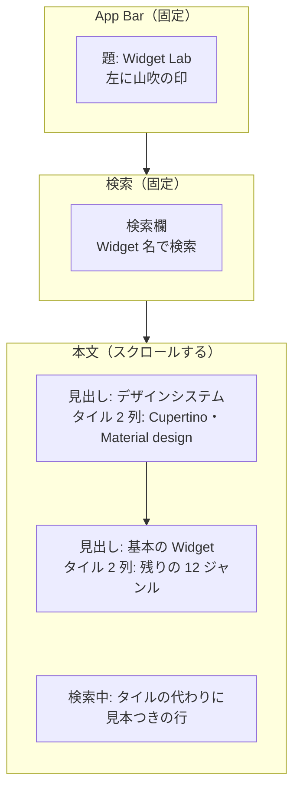
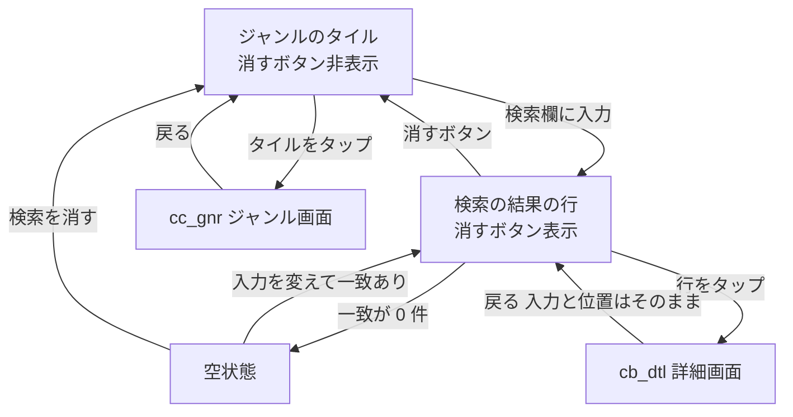

# ca_lst ホーム画面

> **要約**
> - 結論: 検索と、ジャンルのタイル（件数・ジャンル名・代表の名前）を1画面にまとめる。タイルからジャンル画面（cc_gnr）へ、検索の結果から詳細画面（cb_dtl）へ進む
> - 影響: アプリの最初の画面。全部収録すると 242 件になるため、1本のリストをやめて「ジャンルから入る」2段にした（ADR-0004）
> - お願い: 項目と文言の確認

## 概要

| ID | 日本語名 | 英語名 | 画面種別 | 実装種別 | 備考 |
|-|-|-|-|-|-|
| ca_lst | ホーム画面 | CatalogScreen | スクリーン | ネイティブ | 起動時の最初の画面 |

Flutter に戻ってきた人が、全体の地図（ジャンルと件数）を見てジャンルから入るか、名前で探して、確かめたい Widget へ進む。

## デザイン

- ワイヤー: なし（下の mermaid の図）
- デザイン: [Figma](https://www.figma.com/design/W9DAjjGAmMzNhnCQu0BLo7/Widget-Lab?node-id=3-2)「ca_lst 候補 / 案B ジャンルから入る（ホーム）」。色・文字・余白は docs/design-system.md

## バージョン履歴

| 更新日 | バージョン | 更新内容 | 担当者 |
|-|-|-|-|
| 2026/10/28 | 1.0.0 | 初版作成 | Claude（ui-spec） |
| 2026/10/28 | 1.1.0 | 検索欄を `TextField` に。入力を変えると一覧の先頭に戻す | Claude（実装） |
| 2026/10/28 | 2.0.0 | 一覧画面をホーム画面に作り直す。ジャンルの見出しとチップをやめ、ジャンルのタイルにする。ジャンルの中はジャンル画面（cc_gnr）へ分ける。検索の結果は見本つきの行で出す | Claude（ui-spec、Figma の案B） |
| 2026/10/28 | 2.0.1 | 「…」と読み上げの「など」は代表に入りきらないとき（4 件以上）だけ。ABC 順は大文字・小文字を区別しない。題は左寄せ | Claude（実装） |

## 構成

部品は Material 3 の標準（`AppBar`・`TextField`・`ListTile` を土台にした行）。ジャンルのタイルは標準の部品がないので、土台の値で自前に作る（地は `surface`、角丸 `lg`、押せる範囲はタイル全体）。見本つきの行は cc_gnr と同じ部品（`EntryTile`）を使う。

## 接続先一覧

### API

| ID | API 名 | 備考 |
|-|-|-|
| | | |

### 外部接続サービス

| ID | サービス名 | 備考 |
|-|-|-|
| | | |

### ローカル DB

| テーブル名 | 備考 |
|-|-|
| | |

収録データは同梱（`CatalogRepository`。docs/design/functions/demo-engine.md）で、上のどれにも当たらない。

## 状態変化

状態とイベントの型は docs/design/functions/demo-engine.md の「CatalogState」「イベント」。

## 基本方針

- 収録データはアプリに同梱し、通信しない。そのため読み込み中・オフライン・通信のエラーの状態はない
- 件数は「収録している件数」を出す（公式カタログの件数ではない。収録が揃うまでは小さい数になる）
- 収録が 0 件のジャンルはタイルを出さない（押しても空の画面になるため）

## 画面定義

### ab_アプリバー

#### 項目一覧

| ID | 項目名 | 内容 | 状態変化の有無 | 初期表示 | データ取得元 |
|-|-|-|-|-|-|
| ab-mark | 印 | 山吹（`brand`）の小さな丸。飾り | 無 | 表示 | - |
| ab-ttle | 題 | 「Widget Lab」（title2） | 無 | 表示 | - |

#### アクション一覧

| ID | 起動動作 | 内容（状態変化含む） |
|-|-|-|
| ab_アプリバー_全体 | - | 操作なし |

### sr_検索

#### 項目一覧

| ID | 項目名 | 内容 | 状態変化の有無 | 初期表示 | データ取得元 |
|-|-|-|-|-|-|
| sr-fild | 検索欄 | プレースホルダー「Widget 名で検索」。キーボードは英字（`TextInputType.text`、自動の大文字化なし・自動修正なし）。最大 50 文字。左に検索のアイコン、入力があると右に消すボタン | 有 | 空 | ユーザー入力 |
| sr-cler | 消すボタン | アイコンのボタン（✕） | 有 | 非表示 | - |

#### アクション一覧

| ID | 起動動作 | 内容（状態変化含む） |
|-|-|-|
| sr-fild | テキスト入力 | 入力のたびに、名前に入力を含む Widget を探し、タイルの代わりに結果の行を出す（大文字・小文字を区別しない。前後の空白は無視する）。同じ Widget は複数のジャンルに載っていても1回だけ出す。本文を先頭に戻す |
| sr-cler | タップ | 入力を消し、タイルに戻す。キーボードは閉じない |
| sr-fild | キーボードの「完了」 | キーボードを閉じる。結果はそのまま |

#### 表示パターン

##### sr-cler_消すボタン

| パターン名 | 内容 |
|-|-|
| 未入力 | 非表示 |
| 入力あり | 表示 |

### gt_ジャンルのタイル

#### 項目一覧

| ID | 項目名 | 内容 | 状態変化の有無 | 初期表示 | データ取得元 |
|-|-|-|-|-|-|
| gt-head | 段の見出し | 「デザインシステム」（Cupertino・Material design）と「基本の Widget」（残りのジャンル）。footnote、ink-secondary | 無 | 表示 | ローカルアセット（`genres.dart` の区分） |
| gt-tile | ジャンルのタイル | 2 列に並べる。上から件数（title2 の accent の数字と footnote の「件」）、ジャンル名（headline、長い名前は折り返す）、代表の Widget 名をそのジャンルの公式カタログの順に最大 3 件「・」でつなぐ。4 件以上あるときだけ末尾に「…」（footnote、ink-secondary、最大 2 行） | 無 | 収録のあるジャンル | ローカルアセット（収録データ） |

#### アクション一覧

| ID | 起動動作 | 内容（状態変化含む） |
|-|-|-|
| gt-tile | タップ | `cc_gnr_ジャンル画面へ遷移`（Push）。押したジャンルの ID を渡す |

#### 表示パターン

##### gt_ジャンルのタイル

| パターン名 | 内容 |
|-|-|
| 通常 | 2 つの段に、収録のあるジャンルを公式カタログの順で並べる。段のジャンルがすべて 0 件なら段ごと出さない |
| 検索中 | 出さない（sr の結果の行に入れ替える） |

### rs_検索の結果

#### 項目一覧

| ID | 項目名 | 内容 | 状態変化の有無 | 初期表示 | データ取得元 |
|-|-|-|-|-|-|
| rs-item | 見本つきの行 | cc_gnr の ls-item と同じ部品。プロパティ数の印の横に、載っているジャンル名を footnote で添える（例:「Basics・Layout」） | 有 | 非表示 | ローカルアセット（収録データ） |
| rs-empt | 空状態 | 「「{入力}」に一致する Widget はありません」と、「検索を消す」ボタン | 有 | 非表示 | - |

#### アクション一覧

| ID | 起動動作 | 内容（状態変化含む） |
|-|-|-|
| rs-item | タップ | `cb_dtl_詳細画面へ遷移`（Push）。押した Widget を渡す。検索の入力とスクロールの位置は戻ったときにそのまま残す |
| rs-empt | 「検索を消す」をタップ | sr-cler と同じ |
| rs_検索の結果_全体 | スクロール | キーボードが出ていれば閉じる |

#### 表示パターン

##### rs_検索の結果

| パターン名 | 内容 |
|-|-|
| 一致あり | 一致した Widget を、名前の ABC 順（大文字・小文字を区別しない）に並べる |
| 空状態（0 件） | rs-empt だけを表示 |
| 初期表示・ローディング | 該当なし（同梱データを起動時に読むため、待ちが出ない） |
| エラー | 該当なし（通信も読み込みの失敗もない。収録データの不備はテストで防ぐ） |
| オフライン | 該当なし（通信しない） |

## 文言

| 場所 | 文言 |
|-|-|
| 題 | Widget Lab |
| 検索欄のプレースホルダー | Widget 名で検索 |
| 段の見出し | デザインシステム／基本の Widget |
| タイルの件数 | {n} 件 |
| 空状態 | 「{入力}」に一致する Widget はありません |
| 空状態のボタン | 検索を消す |
| 消すボタンの読み上げ | 検索を消す |

## 実装時の考慮事項

- スクロール・固定領域・キーボード表示時: App Bar と検索欄は固定し、本文だけがスクロールする。キーボードが出ても最後のタイル・行まで届く
- 動的コンテンツ: ジャンル名は省略しない（長い名前は折り返す。例:「Assets, images, and icons」）。同じ段のタイルは行ごとに高さをそろえる
- 文字サイズの拡大: OS の設定に Flutter が合わせる（`MediaQuery.textScaler`）。この画面で個別の対応はしない
- タブレット: 本文の最大幅を 640 にして中央に置く。タイルは 2 列のまま
- アクセシビリティ:
  - 読み上げの順は 題 → 検索欄 → 段の見出し → タイル（上から下、左から右）
  - 山吹の印は飾りなので読み上げから外す
  - 段の見出しは見出しとして読む（`Semantics(header: true)`）
  - タイルは「Layout、46 件、Align、Center、Column など。ボタン」と1つにまとめて読む（「など」は 4 件以上のときだけ。3 件以下は「Async、2 件、FutureBuilder、StreamBuilder。ボタン」）
  - 色だけで伝えている状態はない

## 確認・調整事項

- なし
