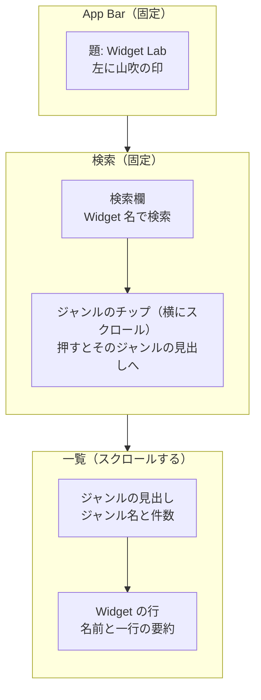
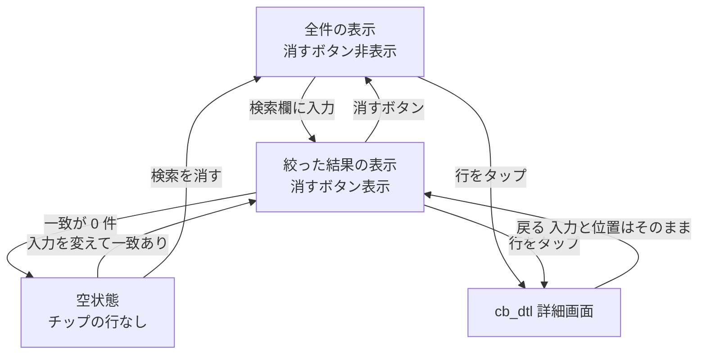

# ca_lst 一覧画面

> **要約**
> - 結論: 全ジャンルを見出しで区切った1本のリストと、名前の検索を1画面にまとめる
> - 影響: アプリの最初の画面。ここから詳細画面（cb_dtl）へ進む
> - お願い: 項目と文言の確認

## 概要

| ID | 日本語名 | 英語名 | 画面種別 | 実装種別 | 備考 |
|-|-|-|-|-|-|
| ca_lst | 一覧画面 | CatalogScreen | スクリーン | ネイティブ | 起動時の最初の画面 |

Flutter に戻ってきた人が、ジャンルをたどるか名前で探して、確かめたい Widget の詳細へ1タップで進む。

## デザイン

- ワイヤー: なし（下の mermaid の図）
- デザイン: なし（docs/design-system.md の Material 3＋土台の色と文字を基準にする）

## バージョン履歴

| 更新日 | バージョン | 更新内容 | 担当者 |
|-|-|-|-|
| 2026/10/28 | 1.0.0 | 初版作成 | Claude（ui-spec） |

## 構成

部品はすべて Material 3 の標準（`AppBar`・`SearchBar`・`ActionChip`・`ListTile`）。主な操作（Widget の行を押す）は画面の大半を占め、親指で届く。

## 接続先一覧

### API

| ID | API 名 | 備考 |
|-|-|-|
| | | |

### 外部接続サービス

| ID | サービス名 | 備考 |
|-|-|-|
| | | |

### ローカル DB

| テーブル名 | 備考 |
|-|-|
| | |

収録データは同梱（`CatalogRepository`。docs/design/functions/demo-engine.md）で、上のどれにも当たらない。

## 状態変化

状態とイベントの型は docs/design/functions/demo-engine.md の「CatalogState」「イベント」。

## 基本方針

- 収録データはアプリに同梱し、通信しない。そのため読み込み中・オフライン・通信のエラーの状態はない
- 検索中も、ジャンルの見出しは残す（どのジャンルの Widget かが分かるように）

## 画面定義

### ab_アプリバー

#### 項目一覧

| ID | 項目名 | 内容 | 状態変化の有無 | 初期表示 | データ取得元 |
|-|-|-|-|-|-|
| ab-mark | 印 | 山吹（`brand`）の小さな丸。飾り | 無 | 表示 | - |
| ab-ttle | 題 | 「Widget Lab」（title2） | 無 | 表示 | - |

#### アクション一覧

| ID | 起動動作 | 内容（状態変化含む） |
|-|-|-|
| ab_アプリバー_全体 | - | 操作なし |

### sr_検索

#### 項目一覧

| ID | 項目名 | 内容 | 状態変化の有無 | 初期表示 | データ取得元 |
|-|-|-|-|-|-|
| sr-fild | 検索欄 | プレースホルダー「Widget 名で検索」。キーボードは英字（`TextInputType.text`、自動の大文字化なし・自動修正なし）。最大 50 文字。左に検索のアイコン、入力があると右に消すボタン | 有 | 空 | ユーザー入力 |
| sr-cler | 消すボタン | アイコンのボタン（✕） | 有 | 非表示 | - |
| sr-chip | ジャンルのチップ | ジャンル名（例:「Basics」「Layout」）を横に並べる。並びは公式カタログの順 | 有 | 全ジャンル | ローカルアセット（収録データ） |

#### アクション一覧

| ID | 起動動作 | 内容（状態変化含む） |
|-|-|-|
| sr-fild | テキスト入力 | 入力のたびに、名前に入力を含む Widget だけに絞る（大文字・小文字を区別しない）。前後の空白は無視する。0件のジャンルは見出しごと隠す。チップも、残った Widget があるジャンルだけにする |
| sr-cler | タップ | 入力を消し、全件に戻す。キーボードは閉じない |
| sr-chip | タップ | そのジャンルの見出しが一覧の上端に来るまでスクロールする |
| sr-fild | キーボードの「完了」 | キーボードを閉じる。絞り込みはそのまま |

#### 表示パターン

##### sr-cler_消すボタン

| パターン名 | 内容 |
|-|-|
| 未入力 | 非表示 |
| 入力あり | 表示 |

##### sr-chip_ジャンルのチップ

| パターン名 | 内容 |
|-|-|
| 通常 | 全ジャンルを表示 |
| 検索中 | 残った Widget があるジャンルだけを表示 |
| 検索の結果が0件 | チップの行ごと隠す |

### ls_一覧

#### 項目一覧

| ID | 項目名 | 内容 | 状態変化の有無 | 初期表示 | データ取得元 |
|-|-|-|-|-|-|
| ls-head | ジャンルの見出し | ジャンル名（title3）と件数（例:「Layout　30」。件数は ink-secondary の footnote） | 有 | 全ジャンル | ローカルアセット（収録データ） |
| ls-item | Widget の行 | 1行目に Widget 名（headline）、2行目に一行の要約（callout、ink-secondary、最大2行で末尾を省略）。右に「›」 | 有 | 全 Widget | ローカルアセット（収録データ） |
| ls-empt | 空状態 | 「「{入力}」に一致する Widget はありません」と、「検索を消す」ボタン | 有 | 非表示 | - |

#### アクション一覧

| ID | 起動動作 | 内容（状態変化含む） |
|-|-|-|
| ls-item | タップ | `cb_dtl_詳細画面へ遷移`（Push）。押した Widget を渡す。検索の入力とスクロールの位置は戻ったときにそのまま残す |
| ls-empt | 「検索を消す」をタップ | sr-cler と同じ |
| ls_一覧_全体 | 一覧をスクロール | キーボードが出ていれば閉じる |

#### 表示パターン

##### ls_一覧

| パターン名 | 内容 |
|-|-|
| データあり | ジャンルの見出しと Widget の行を公式カタログの順に並べる。同じ Widget が複数のジャンルに載っているときは、それぞれのジャンルに出す |
| 検索中（一致あり） | 一致した Widget だけ。見出しの件数は一致した数 |
| 空状態（検索の結果が0件） | ls-empt だけを表示 |
| 初期表示・ローディング | 該当なし（同梱データを起動時に読むため、待ちが出ない） |
| エラー | 該当なし（通信も読み込みの失敗もない。収録データの不備はテストで防ぐ） |
| オフライン | 該当なし（通信しない） |

## 文言

| 場所 | 文言 |
|-|-|
| 題 | Widget Lab |
| 検索欄のプレースホルダー | Widget 名で検索 |
| 空状態 | 「{入力}」に一致する Widget はありません |
| 空状態のボタン | 検索を消す |
| 消すボタンの読み上げ | 検索を消す |

## 実装時の考慮事項

- スクロール・固定領域・キーボード表示時: App Bar と検索（検索欄とチップ）は固定し、一覧だけがスクロールする。キーボードが出ても一覧の最後の行まで届く
- 動的コンテンツ: 要約は最大2行で末尾を「…」で省略する。Widget 名は省略しない（長い名前は折り返す。例: `AnimatedCrossFade`）
- 文字サイズの拡大: 行の高さは文字に合わせて伸ばす（固定しない）。チップは横スクロールのままで、高さを伸ばす
- タブレット: 1カラムのまま、本文の最大幅を 640 にして中央に置く
- アクセシビリティ:
  - 読み上げの順は 題 → 検索欄 → チップ → 見出し → 行（上から下と同じ）
  - 山吹の印は飾りなので読み上げから外す
  - 見出しは見出しとして読む（`Semantics(header: true)`）。件数も「Layout、30 件」と読む
  - 行は「Padding、内側に余白を入れる。ボタン」と1つにまとめて読む
  - 色だけで伝えている状態はない

## 確認・調整事項

- なし
