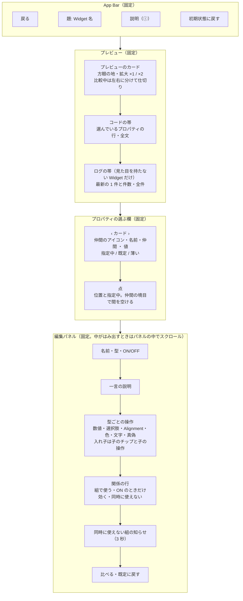
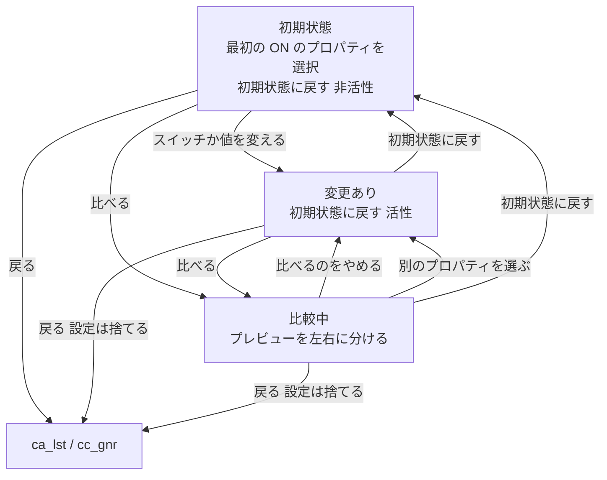

# cb_dtl 詳細画面

> **要約**
> - 結論: 上にプレビューとコードの帯、その下にプロパティの選ぶ欄（‹ カード › と点）、下半分に選んだ1つを大きく触る編集パネルを置く。カードを押すと全部を仲間ごとに並べた一覧のシート。比べるはプレビューを左右に分ける
> - 影響: アプリのコア（プレイグラウンドと比較）。タブ（操作・説明・コード）はやめ、説明はシート、コードは帯と全文のシートにした（ADR-0004）
> - お願い: 項目と文言の確認

## 概要

| ID | 日本語名 | 英語名 | 画面種別 | 実装種別 | 備考 |
|-|-|-|-|-|-|
| cb_dtl | 詳細画面 | DetailScreen | スクリーン（シート: 説明・コードの全文） | ネイティブ | ca_lst・cc_gnr から Push |

1つの Widget について、プロパティを1つずつ選んで値を変え、その場で見た目とコードの変化を確かめ、付けた場合と付けない場合を左右に並べて比べ、今の設定のコードを持ち帰る。

## デザイン

- ワイヤー: なし（下の mermaid の図）
- デザイン: [Figma](https://www.figma.com/design/W9DAjjGAmMzNhnCQu0BLo7/Widget-Lab?node-id=3-2)「cb_dtl v2 / …」の 10 枚（見た目を持たない Widget の 3 枚: MediaQuery・使わない場合と比べる・ログのシート。部品の build の回数の印・ログの帯は「Components（見た目を持たない Widget）」）。v3 の 4 枚: [仲間のタブ](https://www.figma.com/design/W9DAjjGAmMzNhnCQu0BLo7/Widget-Lab?node-id=47-1569)（`47:1569`）・[関係の行](https://www.figma.com/design/W9DAjjGAmMzNhnCQu0BLo7/Widget-Lab?node-id=47-1698)（`47:1698`）・[入れ子と同時に使えない組の知らせ](https://www.figma.com/design/W9DAjjGAmMzNhnCQu0BLo7/Widget-Lab?node-id=47-1824)（`47:1824`）・[補足](https://www.figma.com/design/W9DAjjGAmMzNhnCQu0BLo7/Widget-Lab?node-id=47-1953)（`47:1953`）。v4 の 4 枚（page `3:2`）: ラベル [cb_dtl v4](https://www.figma.com/design/W9DAjjGAmMzNhnCQu0BLo7/Widget-Lab?node-id=74-1669)（`74:1669`）・[width・指定中・先頭](https://www.figma.com/design/W9DAjjGAmMzNhnCQu0BLo7/Widget-Lab?node-id=74-1670)（`74:1670`）・[transformAlignment・既定・薄い](https://www.figma.com/design/W9DAjjGAmMzNhnCQu0BLo7/Widget-Lab?node-id=74-1833)（`74:1833`）・[補足・最後](https://www.figma.com/design/W9DAjjGAmMzNhnCQu0BLo7/Widget-Lab?node-id=74-2010)（`74:2010`）・[一覧のシート](https://www.figma.com/design/W9DAjjGAmMzNhnCQu0BLo7/Widget-Lab?node-id=75-1757)（`75:1757`）。色・文字・余白は docs/design-system.md

## バージョン履歴

| 更新日 | バージョン | 更新内容 | 担当者 |
|-|-|-|-|
| 2026/10/28 | 1.0.0 | 初版作成 | Claude（ui-spec） |
| 2026/10/28 | 2.0.0 | v2 に作り直す。タブをやめ、チップの列と編集パネル・コードの帯・左右の比べる・説明のシート・方眼と拡大にする | Claude（ui-spec、Figma の v2） |
| 2026/10/28 | 2.1.0 | 見た目を持たない Widget（PR 5/5）。回数の印・ログの帯とシート・使った／使わないの比較・コードのシートの切り替えを足す | Claude（ブレインストーミング） |
| 2026/10/29 | 3.0.0 | v3: 仲間のタブ・関係の行・入れ子・補足（docs/design/functions/property-relations.md）。タブ（gt）・関係の行（rl）・入れ子の子のチップ（ne）・補足のタブ（rf）を足し、チップの並びを開いているタブの仲間だけにする | Claude（Figma の v3） |
| 2026/10/29 | 4.0.0 | v4: 仲間のタブ（gt）とチップの列（pc）をやめ、選ぶ欄（ps）と一覧のシート（pss）にする（docs/design/functions/property-picker.md）。値の長い書き方は型の名前だけにする | Claude（ブレインストーミング・Figma の v4） |

## 構成

部品は Material 3 の標準（`AppBar`・`Switch`・`Slider`・`SegmentedButton` / `DropdownMenu`・`ChoiceChip`・`IconButton`・`FilledButton.tonal`・`TextButton`・`SnackBar`・`showModalBottomSheet`）。選ぶ欄の ‹ › は `IconButton.filledTonal`、カードと点・一覧のシートの行は自前。色見本・Alignment の 3×3・比較の仕切り・コードの帯は標準の部品がないので、土台の値で自前に作る。

主な操作（プロパティを選ぶ・値を変える）は画面の下半分にあり、親指で届く。プレビューとコードの帯は操作しても隠れない。

## 前の画面から受け取る値

| データ取得元 | 論理名 | 具体例 | 備考 |
|-|-|-|-|
| ca_lst・cc_gnr | Widget の ID | `container` | `String`。収録データの `WidgetEntry.id`。詳細はこの ID で `CatalogRepository` から引く |

## 接続先一覧

### API

| ID | API 名 | 備考 |
|-|-|-|
| | | |

### 外部接続サービス

| ID | サービス名 | 備考 |
|-|-|-|
| ex-urll | url_launcher（外部のブラウザ） | 説明のシートの ds-link を押したとき |
| ex-clip | クリップボード（Flutter の `Clipboard`） | コードの全文のシートの cd-copy を押したとき |

### ローカル DB

| テーブル名 | 備考 |
|-|-|
| | |

## 状態変化

状態とイベントの型は docs/design/functions/demo-engine.md の「DetailState」「イベント」。比較中にやめたときは、値が最初と同じなら「初期状態」として扱う（`isModified` で判定）。見た目を持たない Widget は「別のプロパティを選ぶ」で比較をやめない（比較中のまま値を変えられる）。見た目を持たない Widget は、比較の開始・終了と「初期状態に戻す」で計測をやり直す（build の回数とログを空にしてデモの木を組み直し、どの子も「build 1 回」から数える）。プロパティを選び替えるだけでは変更にしない。

## 基本方針

- 収録データは同梱。通信するのは「公式ドキュメントを開く」で外部のブラウザを開くときだけ
- プロパティを変えたら、プレビュー・選ぶ欄の値・コードの帯にすぐ反映する（反映の待ちを見せない）
- プレビューの中は収録する Widget の見た目のまま。アプリの UI の色・影を重ねない（design-system の原則1）。方眼はカードの地にだけ描く
- 一度に触るのは 1 つのプロパティ（編集パネル）。全体の状態は選ぶ欄の点と一覧のシートで見渡す

## 画面定義

### ab_アプリバー

#### 項目一覧

| ID | 項目名 | 内容 | 状態変化の有無 | 初期表示 | データ取得元 |
|-|-|-|-|-|-|
| ab-back | 戻る | 標準の戻るボタン | 無 | 表示 | - |
| ab-ttle | 題 | Widget 名（例:「Container」、title2） | 無 | 受け取った Widget 名 | 前の画面から受け取る値 |
| ab-abut | 説明 | アイコンのボタン（ⓘ）。ツールチップ「この Widget について」 | 無 | 表示 | - |
| ab-rset | 初期状態に戻す | アイコンのボタン（↺）。ツールチップ「初期状態に戻す」 | 有 | 非活性 | - |

#### アクション一覧

| ID | 起動動作 | 内容（状態変化含む） |
|-|-|-|
| ab-back | タップ / 戻る操作（Android の戻る・iOS の左端からのスワイプ） | 前の画面へ遷移（Pop）。この画面で変えた設定は捨てる（次に開くと初期状態。確認・調整事項 1 で決定） |
| ab-abut | タップ | 説明のシート（ds）を開く |
| ab-rset | タップ | 全プロパティを最初の値に戻し、比較もやめ、選択を最初の ON のプロパティに戻す。確認のダイアログは出さない（すぐやり直せるため） |

#### 表示パターン

##### ab-rset_初期状態に戻す

| パターン名 | 内容 |
|-|-|
| 初期状態 | 非活性 |
| 1つでも変えた・比較中 | 活性 |

### pv_プレビュー

#### 項目一覧

| ID | 項目名 | 内容 | 状態変化の有無 | 初期表示 | データ取得元 |
|-|-|-|-|-|-|
| pv-card | プレビューのカード | 今の設定で組み立てた Widget を中央に置く。地は `surface` に `outline-variant` の方眼（24 ごと）、角丸 `lg`、影なし。高さは画面の約 3.5 割。はみ出す分はカードの端で切る（子の高さに上限を持たせるため。×2 のときも同じ） | 有 | 最初の値で組み立てたもの | ローカルアセット（収録データ） |
| pv-zoom | 拡大 | 右上のピル「×1」／「×2」（footnote、地は `surface-muted`）。押すたびに切り替える。×2 は見た目を 2 倍に描く（レイアウトの大きさは変えない） | 有 | ×1 | - |
| pv-with | 付けた | 比較中の左半分。左上にラベル「付けた」と✓のアイコン（caption1、地は `surface-muted`）。見た目を持たない Widget は「使った」 | 有 | 非表示 | - |
| pv-wout | 付けない | 比較中の右半分。右上にラベル「付けない」と−のアイコン。見た目を持たない Widget は「使わない」 | 有 | 非表示 | - |
| pv-divd | 仕切り | 比較中の左右の境目。`accent` の縦線と、つまみ（直径 32、押せる範囲 48）。ドラッグで左右に動かせる | 有 | 中央 | ユーザー入力 |
| pv-rbld | build の回数（見た目を持たない Widget だけ） | デモの木で数える子ごとに、右上に重ねる小さな印「build 3 回」（caption1、地は `surface-muted`、角丸 `sm`）。最初の組み立ても 1 回と数える。数が増えた瞬間だけ地を `accent` に光らせる（200ms。最初の組み立ての 0 → 1 では光らせない。「視差効果を減らす」が ON なら光らせない）。印が書き変わっても、数えている子は組み直さない | 有 | build 1 回 | DemoProbe（docs/design/functions/demo-engine.md） |
| pv-tree | デモの木（見た目を持たない Widget だけ） | 収録データが組むデモの木。子ごとに枠と名前の札（caption1、ink-secondary）を付け、木の形が分かるようにする。中身は Widget ごと（demo-engine.md の「見た目を持たない Widget の収録」） | 有 | 最初の値で組み立てたもの | ローカルアセット（収録データ） |

#### アクション一覧

| ID | 起動動作 | 内容（状態変化含む） |
|-|-|-|
| pv-card | プレビューの中の操作 | 収録する Widget そのものの動き（ボタンを押す・スクロールする など）。アプリは横取りしない |
| pv-zoom | タップ | ×1 と ×2 を切り替える。比較中も 2 枚に同じ倍率をかける |
| pv-divd | ドラッグ | 仕切りを左右に動かす（カードの幅の 10〜90% の間）。比較をやめると中央に戻る |

#### 表示パターン

##### pv_プレビュー

| パターン名 | 内容 |
|-|-|
| 通常 | pv-card 1 枚 |
| 比較中 | 同じ位置に「付けた」と「付けない」を重ね、仕切りの左に「付けた」、右に「付けない」を見せる。比べているプロパティ以外の設定は 2 枚とも同じ |
| 見た目を持たない Widget | pv-card の中に pv-tree と pv-rbld を置く。コードの帯の下にログの帯（lg）を出す |
| 見た目を持たない Widget の比較中 | 左に「使った」（収録データの `build`）、右に「使わない」（`buildWithout`）。比べるのはプロパティではなく Widget そのもの。編集パネルで変えた値は 2 枚に同じく効く。pv-rbld は左右で別に数える |

### cs_コードの帯

#### 項目一覧

| ID | 項目名 | 内容 | 状態変化の有無 | 初期表示 | データ取得元 |
|-|-|-|-|-|-|
| cs-line | 帯 | 選んでいるプロパティのコードの 1 行（例: `padding: EdgeInsets.all(16.0),`。文字は `code`、地は `surface-muted`、角丸 `md`、高さ 44、末尾を省略）。既定から変えた行なら左に `accent` の縦線。プロパティが OFF なら「// padding は指定なし（既定値）」を ink-secondary で | 有 | 最初の選択の行 | - |
| cs-open | 全文 | 帯の右端の「全文 ›」（footnote、accent）。帯全体が押せる | 無 | 表示 | - |

#### アクション一覧

| ID | 起動動作 | 内容（状態変化含む） |
|-|-|-|
| cs-line | タップ | コードの全文のシート（cd）を開く |

### lg_ログの帯（見た目を持たない Widget だけ）

#### 項目一覧

| ID | 項目名 | 内容 | 状態変化の有無 | 初期表示 | データ取得元 |
|-|-|-|-|-|-|
| lg-last | 最新のログ | 最新の 1 件の文（例:「読む子を build（4 回目）」。footnote、地は `surface-muted`、角丸 `md`、高さ 44、末尾を省略）。比較中は文の前に側の札（「使った」「使わない」、caption1）。まだ何もなければ「まだ何も起きていません」を ink-secondary で | 有 | 最初の組み立てのログ | ProbeNotifier |
| lg-cont | 件数 | 帯の右端に「{n} 件 ›」（footnote、accent）。帯全体が押せる | 有 | 表示 | ProbeNotifier |

#### アクション一覧

| ID | 起動動作 | 内容（状態変化含む） |
|-|-|-|
| lg-last | タップ | ログのシート（lgs）を開く |

### lgs_ログのシート

#### 項目一覧

| ID | 項目名 | 内容 | 状態変化の有無 | 初期表示 | データ取得元 |
|-|-|-|-|-|-|
| lgs-head | 見出し | 「ログ」（title3）と、右に `TextButton`「ログを消す」 | 無 | 表示 | - |
| lgs-list | ログの一覧 | 新しい順に最大 50 件。1 行に時刻（`HH:mm:ss`、caption1、ink-secondary）・側の札（比較中に起きたものだけ）・文（subheadline）。同じフレームに同じ出来事が重なったら「ScrollUpdateNotification ×6」のように 1 行にまとめる。開いている間に起きたものもすぐ足す | 有 | 今のログ | ProbeNotifier |
| lgs-empt | 空 | 「まだ何も起きていません」（ink-secondary、中央） | 有 | ログが 0 件のときだけ | - |

#### アクション一覧

| ID | 起動動作 | 内容（状態変化含む） |
|-|-|-|
| lgs-head | 「ログを消す」をタップ | ログと pv-rbld の回数を 0 に戻す（確認は出さない）。シートは開いたまま lgs-empt を出す |
| lgs_シート_全体 | 下へスワイプ・外をタップ | シートを閉じる |

### ps_選ぶ欄

プレビュー（とコード・ログの帯）の下、編集パネルの上に置く。プロパティが 1 つで補足もない Widget は、‹ › と点を出さずにカードだけを出す。プロパティが 0 件の Widget は何も出さない。送る順番は、仲間のないプロパティ → 仲間（語彙の順：大きさ・余白・配置・色と装飾・変形・文字・挙動・中身）→ 補足（`references` があるときだけ）。

#### 項目一覧

| ID | 項目名 | 内容 | 状態変化の有無 | 初期表示 | データ取得元 |
|-|-|-|-|-|-|
| ps-prev | 前へ（‹） | `IconButton.filledTonal`（直径 40、押せる範囲 48×48）。ツールチップ「前のプロパティ」。地は `accent-container`、記号は `accent`。先頭では非活性 | 有 | 先頭なら非活性 | DetailState |
| ps-card | カード | 今のプロパティを 1 枚で見せる。中身は仲間のアイコン・名前（titleSmall・1 行）・「{仲間} ・ {値}」（labelMedium・1 行）・右端に ⌄。名前と値は収まらなければ末尾を「…」にする。値は短い表示（スライダーは整数なら小数点を省く。変えられない値は 20 文字までは書き方のまま、超えたら先頭の型の名前だけ、`[` で始まるものは `[型]`。OFF は「既定」）。高さは最小 56（文字を大きくしたら中身に合わせて高くする）、角丸は `NimiRadius` の md（12）、押せる範囲は全体。補足を選んでいるときは、アイコン `notes`・名前「補足」・「{n} 件 ・ 読むだけ」で枠だけ | 有 | 最初の ON のプロパティ（なければ先頭） | ローカルアセット（収録データ）・DetailState |
| ps-next | 次へ（›） | ps-prev と同じ見た目。ツールチップ「次のプロパティ」。最後では非活性。最後のプロパティの次は補足（あるとき） | 有 | 最後なら非活性 | DetailState |
| ps-dots | 点 | 1 つのプロパティに 1 つの点（6×6）。間は 4、仲間の境目は 8 空け、補足は最後に境目を空けて輪（中を塗らない点）で出す。今の位置は横に長い点（18×6、`accent`）、指定中は `accent` の薄い色（40%）、既定は `outline-variant`。収まらないときは全体を縮める（`FittedBox`）。飾りなので押せず、読み上げない。キーボードが出ている間は隠れる（カードと ‹ › は出たまま）。高さ 16 | 有 | 全プロパティ分 | DetailState |

#### アクション一覧

| ID | 起動動作 | 内容（状態変化含む） |
|-|-|-|
| ps-prev | タップ | 前のプロパティを選び、編集パネルの中身を切り替える。比較中なら比較をやめる（見た目を持たない Widget は比べるのを続け、値の変化を左右で見られるようにする） |
| ps-next | タップ | 次のプロパティ（最後の次は補足）を選ぶ。そのほかは ps-prev と同じ |
| ps-card | タップ | 一覧のシート（pss）を開く |
| ps-card | 読み上げの上下スワイプ（`onIncrease` / `onDecrease`） | 次・前のプロパティを選ぶ。ダブルタップでシートを開く |

#### 表示パターン

##### ps-card_カード

| パターン名 | 内容 |
|-|-|
| 指定中（ON） | 地は `accent`、文字は `on-accent` |
| 既定（OFF） | 地なし、`outline` の枠、値は「既定」 |
| 薄い | `requires` の相手が OFF で効かないプロパティ。ほかの見た目のまま 50% の不透明度で描く（押せる） |
| 補足 | 枠だけ。アイコン `notes`・名前「補足」・「{n} 件 ・ 読むだけ」 |

仲間のアイコン（Material Icons）: なし `tune`、大きさ `aspect_ratio`、余白 `padding`、配置 `align_horizontal_center`、色と装飾 `palette`、変形 `transform`、文字 `text_fields`、挙動 `touch_app`、中身 `widgets`、補足 `notes`。

読み上げはカードを 1 つの「調整できる項目」として「{名前}、{仲間}、{値}、{i} / {n}」と読む（値は完全な書き方）。

### pss_一覧のシート

#### 項目一覧

| ID | 項目名 | 内容 | 状態変化の有無 | 初期表示 | データ取得元 |
|-|-|-|-|-|-|
| pss-head | 題 | `showDetailSheet` で開く。題「プロパティ（{n}）」（titleMedium）と、横に「指定中 {m}」（ON の数。bodySmall・ink-secondary） | 有 | 開いたとき | ローカルアセット（収録データ）・DetailState |
| pss-sect | 仲間の見出し | 仲間ごとにアイコン＋仲間の名前。仲間のないプロパティが先、続いて語彙の順。最後に「補足」の見出し（補足があるときだけ） | 無 | 全仲間 | ローカルアセット（収録データの `group`） |
| pss-row | 行 | 「● / ○ 名前 …… 値」。● は指定中、○ は既定。名前は行の幅の 60% までで、値は残りを使って右にそろえ、どちらも長ければ「…」にする。効かないものは 50% の不透明度。今選んでいる行は `accent-container` の地と ✓。開いたときは今の行が見える位置まで送る | 有 | 今の行に ✓ | ローカルアセット・DetailState |
| pss-refs | 補足の行 | 「補足」の見出しの下に「{n} 件」の 1 行 | 有 | 補足があるときだけ | ローカルアセット（収録データの `references`） |

#### アクション一覧

| ID | 起動動作 | 内容（状態変化含む） |
|-|-|-|
| pss-row / pss-refs | タップ | そのプロパティ（または補足）を選んでシートを閉じる。比較中なら ps-prev と同じく扱う |
| pss-head | 下へスワイプ・外をタップ | シートを閉じる |

### rl_関係の行

#### 項目一覧

| ID | 項目名 | 内容 | 状態変化の有無 | 初期表示 | データ取得元 |
|-|-|-|-|-|-|
| rl-pair | 組で使う | 編集パネルの値の操作の下に 1 行。「↔ {相手} と組で使うことが多い」（subheadline、相手の名前は `accent` のリンク）。向きは問わない（`pairsWith`） | 無 | 関係があるときだけ | ローカルアセット（収録データの `pairsWith`） |
| rl-reqd | ON のときだけ効く | 「{相手} が ON のときだけ効く」。相手が OFF の間は後ろに「（今は OFF）」を足し、このプロパティのカードを薄くする。相手が OFF の間は、説明のすぐ下に「{相手} を ON にする」ボタン（tonal）を出し、押すと選んだまま相手を ON にする（`requires`） | 有 | 関係があるときだけ | ローカルアセット（収録データの `requires`）・DetailState |
| rl-excl | 同時に使えない | 「{相手} と同時には使えない」（`excludes`。両方向に書いてあるので、どちらのプロパティを選んでも出る） | 無 | 関係があるときだけ | ローカルアセット（収録データの `excludes`） |

#### アクション一覧

| ID | 起動動作 | 内容（状態変化含む） |
|-|-|-|
| rl-pair / rl-reqd / rl-excl | 相手の名前をタップ | 相手を選ぶ（カードがそこへ移る）。比較中ならやめる |

#### 同時に使えない組の知らせ

| ID | 項目名 | 内容 | 状態変化の有無 | 初期表示 |
|-|-|-|-|-|
| rl-note | 知らせ | 片方を ON にしたとき、`excludes` のもう片方が ON なら OFF にし、編集パネルに「{ON にした側} と同時には使えないので {OFF にした側} を OFF にしました」を出す（footnote、地は `surface-muted`、角丸 `sm`）。ライブリージョンで、読み上げに伝える。3 秒で消える。ほかのプロパティを選んでも消える。OFF にした側の値は覚えておく（ed-swch と同じ） | 有 | 非表示 |

### ne_入れ子

入れ子のプロパティ（`children` を持つもの。Container の decoration・foregroundDecoration）を選んだときの編集パネル。

#### 項目一覧

| ID | 項目名 | 内容 | 状態変化の有無 | 初期表示 | データ取得元 |
|-|-|-|-|-|-|
| ne-chip | 子のチップ | 値の操作の代わりに、見出し「中の値」と子のチップの列（名前と今の値。値は短い表示で、長い書き方は型の名前だけ。見た目は指定中・既定・薄いの 3 つ）を出す。例: decoration の color・borderRadius・border・boxShadow・gradient・shape。foregroundDecoration は color・border | 有 | 最初の ON の子（なければ最初の子） | ローカルアセット（収録データの `children`） |
| ne-sw | 子の ON/OFF | 選んだ子のスイッチ（ed-swch と同じ）。親が OFF なら子は効かない | 有 | 子の収録データに従う | ローカルアセット |
| ne-valu | 子の値の操作 | 選んだ子の型ごとの部品（ed-valu と同じ）。OFF のときは非活性 | 有 | 子の最初の値 | ユーザー入力 |
| ne-line | 帯の子の行 | 子を選んでいる間、cs-line に選んだ子の 1 行を出す（例: `borderRadius: BorderRadius.circular(12.0),`）。子が OFF なら「// decoration.borderRadius は指定なし（既定値）」（名前は `親.子`） | 有 | - | - |

- コードの全文は、`decoration: BoxDecoration(` の次の行から ON の子を 1 行ずつ字下げして書き、`),` で閉じる。ON の子がなければ `decoration: const BoxDecoration(),`
- 子に `omitIf` があるものは、条件に当たる間コードにも書かず、プレビューにも渡さない（Container は decoration の shape が circle の間、borderRadius を渡さない）。top-level でも同じで、color は decoration が ON の間、clipBehavior は decoration が OFF の間は渡さない（プレビューは `Clip.none`）
- 比べるのは、選んだ子 1 つの付けた／付けない（`ComparingProperty(name, child: 子)`）

#### アクション一覧

| ID | 起動動作 | 内容（状態変化含む） |
|-|-|-|
| ne-chip | タップ | その子を選び、ne-sw・ne-valu・ne-line を切り替える。比較中ならやめる |
| ne-sw | タップ | 子の ON/OFF を切り替え、プレビュー・子のチップ・コードにすぐ反映する |
| ne-valu | 値の操作 | プレビュー・子のチップ・コードにすぐ反映する |

### rf_補足

#### 項目一覧

| ID | 項目名 | 内容 | 状態変化の有無 | 初期表示 | データ取得元 |
|-|-|-|-|-|-|
| rf-ttle | 見出し | 「見た目が変わらない引数」（title3）と、その下に「触っても見た目は変わりません。コードを書くときの手がかりに載せています。」（subheadline、ink-secondary） | 無 | 補足を選んだとき | - |
| rf-list | 一覧 | 引数ごとに 1 行。名前（headline）・型（footnote、ink-secondary）・一言の説明（subheadline）。読むだけで、押せず、ON/OFF も値の操作もない（例: Container の `key`） | 無 | 収録データの `references` の順 | ローカルアセット（収録データの `references`） |

補足を選んでいる間は、編集パネルの代わりに rf を出し、「比べる」「既定に戻す」を出さない。コードの帯は最後に選んでいたプロパティの行のまま。

### ed_編集パネル

#### 項目一覧

| ID | 項目名 | 内容 | 状態変化の有無 | 初期表示 | データ取得元 |
|-|-|-|-|-|-|
| ed-name | プロパティ名と型 | 名前（title3）と、その下に型（footnote、ink-secondary） | 有 | 最初の選択 | ローカルアセット（収録データ） |
| ed-swch | ON/OFF | スイッチ。ON は「付ける（値を指定する）」、OFF は「付けない（既定値）」 | 有 | 収録データの最初の値に従う | ローカルアセット（収録データ） |
| ed-reqd | 必須の印 | 必須のプロパティは、スイッチの代わりに「必須」（footnote、地は `surface-muted`、角丸 `sm`） | 無 | 必須のときだけ | ローカルアセット（収録データ） |
| ed-desc | 一言の説明 | 例:「箱の内側、子のまわりの余白。色はこの余白にも塗られます。」（subheadline、ink-secondary） | 有 | 表示 | ローカルアセット（収録データ） |
| ed-valu | 値の操作 | 型ごとの部品（下の表示パターン）。OFF のときは非活性 | 有 | 収録データの最初の値 | ユーザー入力 |
| ed-cmpr | 比べる | `FilledButton.tonal`「比べる」と⇅のアイコン。比較中は地が `accent` で「比べるのをやめる」。見た目を持たない Widget は「使わない場合と比べる」 | 有 | 表示 | - |
| ed-dflt | 既定に戻す | `TextButton`「既定に戻す」と↺のアイコン。このプロパティだけを最初の値に戻す | 有 | 非活性 | - |
| ed-rel | 関係の行・知らせ | 値の操作の下に rl の行（関係があるときだけ）。知らせ（rl-note）は出ている間だけ | 有 | 関係があるときだけ | ローカルアセット（収録データ） |
| ed-none | プロパティがない | 「この Widget には変えられるプロパティがありません」（例: 子を受け取るだけの Widget）。選ぶ欄と比べるも出さない | 有 | プロパティが 0 件のときだけ | - |

#### アクション一覧

| ID | 起動動作 | 内容（状態変化含む） |
|-|-|-|
| ed-swch | タップ | ON/OFF を切り替え、プレビュー・選ぶ欄・コードの帯にすぐ反映する。OFF にしても値は覚えておき、ON に戻すとその値に戻る |
| ed-valu | スライダーを動かす / 選ぶ / 入力する | プレビュー・選ぶ欄・コードの帯にすぐ反映する |
| ed-cmpr | タップ | 選んでいるプロパティを付けた／付けないで比べる（pv の「比較中」）。プロパティが OFF のときも押せて、「付けた」側は覚えている値（なければ収録データの最初の値）を使う。比較中にもう一度押すと比較をやめる。見た目を持たない Widget は、どのプロパティを選んでいても Widget そのものを使った／使わないで比べる |
| ed-dflt | タップ | 選んでいるプロパティの ON/OFF と値を最初の値に戻す |

#### 表示パターン

##### ed-valu_値の操作

| パターン名 | 内容 |
|-|-|
| 数値（`SliderControl`） | 太いスライダー（トラック 6、つまみ 24）。つまみの上に値の吹き出し（例:「16.0」、地は `accent`）。段の位置に目盛りの点、下に最小・最大と途中の値（caption1） |
| 選択肢 4 つまで（`ChoiceControl`） | `SegmentedButton` |
| 選択肢 5 つ以上（`ChoiceControl`） | `DropdownMenu`。ただし値が Alignment の 9 つなら 3×3 のマス（下） |
| Alignment（9 つの `ChoiceControl`） | 3×3 のマス（1 マス 48×48、地は `surface`、全体の地は `surface-muted`、角丸 `sm`）。選んだマスは `accent` の地に `on-accent` の点。右に選んだ名前（headline）とコード（`Alignment.center`、code） |
| 色（`ColorControl`） | 色見本（直径 52）を横に並べ、下に色の名前（caption1）。選んだものは✓と `ink` の輪 |
| 文字（`TextControl`） | 1 行の入力欄（最大文字数は収録データの `maxLength`） |
| 真偽（`SwitchControl`） | 値のスイッチ（ed-swch とは別）と「true / false」の表示 |
| 固定の値（`FixedControl`） | 値の操作なし。コードでの書き方（例: `FlutterLogo()`、code）を ink-secondary で出す |
| OFF | 操作は非活性（`surface-muted` の地、値は ink-secondary） |

##### ed-dflt_既定に戻す

| パターン名 | 内容 |
|-|-|
| 最初の値のまま | 非活性 |
| 変えた | 活性 |

### cd_コードの全文のシート

#### 項目一覧

| ID | 項目名 | 内容 | 状態変化の有無 | 初期表示 | データ取得元 |
|-|-|-|-|-|-|
| cd-head | 見出し | 「コード」（title3）と、右に凡例「既定から変えた行」（`accent` の縦線と footnote） | 無 | 表示 | - |
| cd-side | 使った／使わない | 見出しの下に `SegmentedButton`「使った」「使わない」。収録データに使わない側のコード（`codeWithout`）がある Widget だけ。「使わない」はそのコードを cd-code に出す（変えた行の印は付けない） | 有 | 使った | ローカルアセット（収録データ） |
| cd-code | コード | 今の設定を再現する Dart のコード。行番号つき、地は `surface-muted`、角丸 `md`、文字は `code`。既定から変えた行は地が `accent-container` で左に `accent` の縦線。長い行は横にスクロール。文字を選べる | 有 | 開いたときの設定のコード | - |
| cd-copy | コピー | `FilledButton.tonal`「コードをコピー」（幅いっぱい） | 無 | 表示 | - |

#### アクション一覧

| ID | 起動動作 | 内容（状態変化含む） |
|-|-|-|
| cd-side | タップ | cd-code を使った側・使わない側のコードに切り替える |
| cd-copy | タップ | cd-code に出ている全文をクリップボードに入れ、Snackbar「コードをコピーしました」（成功のアイコンつき）。書けなかったら Snackbar「コピーできませんでした」 |
| cd_シート_全体 | 下へスワイプ・外をタップ | シートを閉じる |

### ds_説明のシート

#### 項目一覧

| ID | 項目名 | 内容 | 状態変化の有無 | 初期表示 | データ取得元 |
|-|-|-|-|-|-|
| ds-ttle | 見出し | 「{Widget 名} について」（title3） | 無 | 表示 | ローカルアセット（収録データ） |
| ds-genr | ジャンル | 例:「Basics」「Layout」（footnote、地は `surface-muted`、角丸 `sm`） | 無 | 表示 | ローカルアセット（収録データ） |
| ds-summ | 説明 | 公式 API ドキュメントをもとにした日本語の説明（body、です・ます調） | 無 | 表示 | ローカルアセット（収録データ） |
| ds-try | 試してみる | 後の段。収録データに「試してみる」の一文があるときだけ（地は `surface-muted`、角丸 `md`） | 無 | 非表示 | ローカルアセット（収録データ） |
| ds-link | 公式ドキュメントを開く | `FilledButton.tonal`「公式ドキュメントを開く」。外へ出るアイコンつき | 無 | 表示 | ローカルアセット（収録データの URL） |

#### アクション一覧

| ID | 起動動作 | 内容（状態変化含む） |
|-|-|-|
| ds-link | タップ | 公式の API ドキュメントの該当ページを外部のブラウザで開く。開けなかったら Snackbar「ブラウザを開けませんでした」 |
| ds_シート_全体 | 下へスワイプ・外をタップ | シートを閉じる |

## 後の段（この版では作らない）

| 項目 | 内容 | 要るもの |
|-|-|-|
| ガイド | プレビューに子の範囲の点線と「padding 16」のような値の印を出す（Figma「cb_dtl v2 / padding を編集」） | 子の位置と大きさを測る仕組み |
| よく使う値 | 数値のスライダーの下に、よく使う値のボタン（0・8・16・24・32 など） | 収録データの `SliderControl` に候補の項目 |
| 試してみる | 説明のシートの ds-try | 収録データに一文の項目 |

## 文言

| 場所 | 文言 |
|-|-|
| 説明（ツールチップ・読み上げ） | この Widget について |
| 初期状態に戻す（ツールチップ・読み上げ） | 初期状態に戻す |
| 拡大 | ×1／×2（読み上げ: 等倍で表示／2 倍で表示） |
| 比較のラベル | 付けた／付けない（見た目を持たない Widget は 使った／使わない） |
| 仕切り（読み上げ） | 比較の仕切り |
| 全文 | 全文 |
| OFF のプロパティの帯 | // {プロパティ名} は指定なし（既定値） |
| 選ぶ欄の値（OFF） | 既定 |
| 比べる | 比べる／比べるのをやめる（見た目を持たない Widget は 使わない場合と比べる／比べるのをやめる） |
| 回数の印 | build {n} 回 |
| ログの帯の件数 | {n} 件 |
| ログの空 | まだ何も起きていません |
| ログの見出し | ログ |
| ログを消す | ログを消す |
| コードの側 | 使った／使わない |
| 既定に戻す | 既定に戻す |
| 必須の印 | 必須 |
| プロパティがない | この Widget には変えられるプロパティがありません |
| コードの見出し | コード |
| 凡例 | 既定から変えた行 |
| コピー | コードをコピー |
| コピーの成功 | コードをコピーしました |
| コピーの失敗 | コピーできませんでした |
| 説明の見出し | {Widget 名} について |
| 公式ドキュメント | 公式ドキュメントを開く |
| リンクのエラー | ブラウザを開けませんでした |
| 仲間の名前（カード・一覧のシートの見出し） | 大きさ／余白／配置／色と装飾／変形／文字／挙動／中身 |
| 仲間を決めていない収録の見出し（補足があるときだけ） | プロパティ |
| 補足（カード・一覧のシートの見出し） | 補足 |
| 補足のカードの値 | {n} 件 ・ 読むだけ |
| ‹ ›（ツールチップ・読み上げ） | 前のプロパティ／次のプロパティ |
| カードの読み上げ | {名前}、{仲間}、{値}、{i} / {n} |
| 一覧のシートの題 | プロパティ（{n}）／指定中 {m} |
| 入れ子の子のチップの見出し | 中の値 |
| 関係の行（組で使う） | {相手} と組で使うことが多い |
| 関係の行（ON のときだけ効く） | {相手} が ON のときだけ効く（今は OFF） |
| 相手を ON にするボタン | {相手} を ON にする |
| 関係の行（同時に使えない） | {相手} と同時には使えない |
| 同時に使えない組の知らせ | {ON にした側} と同時には使えないので {OFF にした側} を OFF にしました |
| 補足の見出し | 見た目が変わらない引数 |
| 補足の説明 | 触っても見た目は変わりません。コードを書くときの手がかりに載せています。 |
| 子が OFF のときの帯 | // {親}.{子} は指定なし（既定値） |

## 実装時の考慮事項

- スクロール・固定領域・キーボード表示時: App Bar・プレビュー・コードの帯・選ぶ欄は固定し、編集パネルの中身がはみ出すときはパネルの中でスクロールする。文字の入力欄でキーボードが出たら、プレビューの高さを縮めて（最小は画面の高さの約 2 割）入力欄が隠れないようにし、編集パネルの高さを守るため選ぶ欄の点を隠す（カードと ‹ › は出たまま）
- アニメーション: 値の変化そのものの動き（`AnimatedContainer` など）は Widget のまま。アプリ側で足すのは、比較の 1 枚 ↔ 左右の切り替え（200ms 程度のフェード）と、編集パネルの中身の切り替え（150ms 程度のフェード）だけ。端末の「視差効果を減らす」が ON なら即時
- OS 別の対応: 戻る操作は OS の標準。Cupertino の Widget も Android でそのまま表示する（PRD）
- 動的コンテンツ: 型の名前が長いとき（例: `MainAxisAlignment`）は折り返す。コードは折り返さず横スクロール（帯は末尾を省略）
- 文字サイズの拡大: OS の設定に Flutter が合わせる（`MediaQuery.textScaler`）。この画面で個別の対応はしない
- タブレット: 1 カラムのまま、本文の最大幅を 640 にして中央に置く
- アクセシビリティ:
  - 読み上げの順は 戻る → 題 → 説明 → 初期状態に戻す → プレビュー → コードの帯 →（ログの帯）→ 選ぶ欄（‹ → カード → ›）→ 編集パネル（点は読み上げない）
  - 回数の印は「読む子、build 4 回」と読む。光る動きは読み上げない。ログの帯は「ログ、12 件、最新: 読む子を build。ボタン」と読む
  - カードは「padding、16、余白、3 / 21。ボタン」のように読み、上下のスワイプで前後に送り、ダブルタップで一覧のシートを開く。同時に使えない組の知らせはライブリージョンで読み上げる。薄いカードも名前と値は同じように読む
  - 比較のラベルは文言とアイコンで示し、色だけに頼らない。比較中のプレビューは「付けた、color、瑠璃」「付けない」と読む
  - 仕切りはドラッグのほかに、読み上げの調整操作（`Semantics` の increase / decrease）で 10% ずつ動かせる
  - スイッチは「padding を付ける、オン」と読む。スライダーは今の値を読む。Alignment のマスは「topLeft、ボタン」と読み、選んだものは「選択中」
  - アイコンだけのボタン（説明・初期状態に戻す・拡大）にラベルを付ける
  - プレビューの中は収録する Widget の Semantics のまま（アプリは足さない）

## 確認・調整事項

- [cb_dtl_詳細画面_確認・調整事項.md](cb_dtl_詳細画面_確認・調整事項.md)
