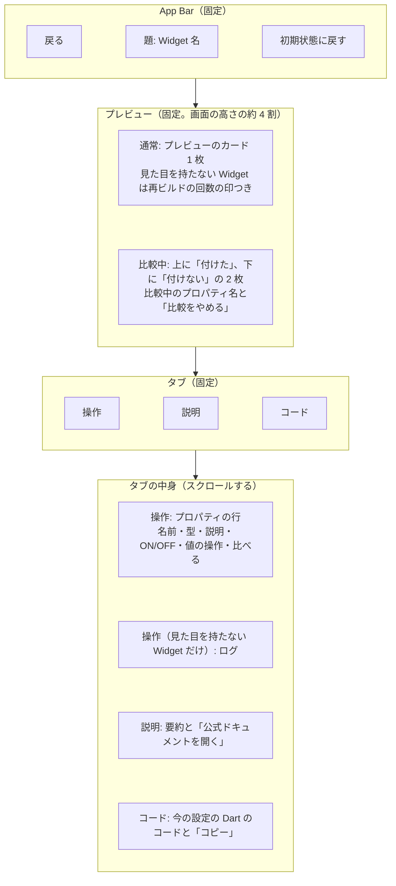
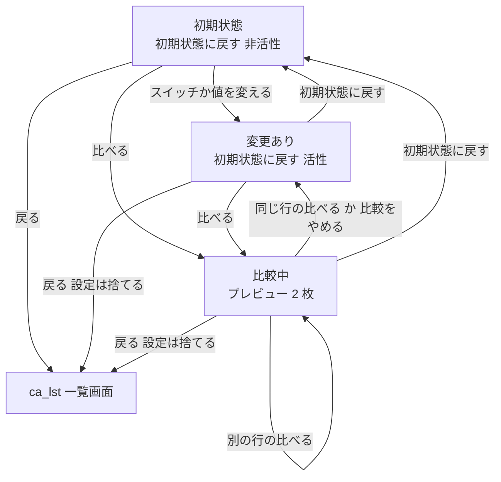

# cb_dtl 詳細画面

> **要約**
> - 結論: プレビューを上に固定し、下を「操作」「説明」「コード」のタブにする。比較は操作パネルの行ごとの「比べる」で、プレビューを上下2枚に分ける
> - 影響: アプリのコア（プレイグラウンドと比較）。見た目を持たない Widget も、同じ画面で可視化して見せる
> - お願い: 項目と文言の確認

## 概要

| ID | 日本語名 | 英語名 | 画面種別 | 実装種別 | 備考 |
|-|-|-|-|-|-|
| cb_dtl | 詳細画面 | DetailScreen | スクリーン（タブ: 操作・説明・コード） | ネイティブ | ca_lst から Push |

1つの Widget について、プロパティを変えてその場で見た目を確かめ、付けた場合と付けない場合を並べて比べ、今の設定のコードを持ち帰る。

## デザイン

- ワイヤー: なし（下の mermaid の図）
- デザイン: なし（docs/design-system.md の Material 3＋土台の色と文字を基準にする）

## バージョン履歴

| 更新日 | バージョン | 更新内容 | 担当者 |
|-|-|-|-|
| 2026/10/28 | 1.0.0 | 初版作成 | Claude（ui-spec） |
| 2026/10/28 | 1.0.1 | pv-card をスクロールさせない形に変更し、外枠の線を足す。比較のカード・スイッチ・値の操作の読み上げの文言、横向きとキーボードのときのプレビューの高さを足す | Claude（実装 PR 4/5） |

## 構成

部品は Material 3 の標準（`AppBar`・`TabBar`・`Switch`・`Slider`・`SegmentedButton` / `DropdownMenu`・`IconButton`・`FilledButton.tonal`・`SnackBar`）。色のパレットだけは標準の部品がないので、土台の値で自前に作る（チップの形の色見本を横に並べる）。

主な操作（スイッチ・スライダー）は画面の下半分のタブの中にあり、親指で届く。プレビューは操作しても隠れない。

## 前の画面から受け取る値

| データ取得元 | 論理名 | 具体例 | 備考 |
|-|-|-|-|
| ca_lst | Widget の ID | `padding` | `String`。収録データの `WidgetEntry.id`。詳細はこの ID で `CatalogRepository` から引く |

## 接続先一覧

### API

| ID | API 名 | 備考 |
|-|-|-|
| | | |

### 外部接続サービス

| ID | サービス名 | 備考 |
|-|-|-|
| ex-urll | url_launcher（外部のブラウザ） | ds-link を押したとき |
| ex-clip | クリップボード（Flutter の `Clipboard`） | cd-copy を押したとき |

### ローカル DB

| テーブル名 | 備考 |
|-|-|
| | |

## 状態変化

状態とイベントの型は docs/design/functions/demo-engine.md の「DetailState」「ProbeState」「イベント」。比較中にやめたときは、値が最初と同じなら「初期状態」として扱う（`isModified` で判定）。

## 基本方針

- 収録データは同梱。通信するのは「公式ドキュメントを開く」で外部のブラウザを開くときだけ
- プロパティを変えたら、プレビューとコードにすぐ反映する（反映の待ちを見せない）
- プレビューの中は収録する Widget の見た目のまま。アプリの UI の色・影を重ねない（design-system の原則1）。例外は pv-card の外枠の線だけ

## 画面定義

### ab_アプリバー

#### 項目一覧

| ID | 項目名 | 内容 | 状態変化の有無 | 初期表示 | データ取得元 |
|-|-|-|-|-|-|
| ab-back | 戻る | 標準の戻るボタン | 無 | 表示 | - |
| ab-ttle | 題 | Widget 名（例:「Padding」、title2） | 無 | 受け取った Widget 名 | 前の画面から受け取る値 |
| ab-rset | 初期状態に戻す | アイコンのボタン（↺）。長押しのツールチップ「初期状態に戻す」 | 有 | 非活性 | - |

#### アクション一覧

| ID | 起動動作 | 内容（状態変化含む） |
|-|-|-|
| ab-back | タップ / 戻る操作（Android の戻る・iOS の左端からのスワイプ） | `ca_lst_一覧画面へ遷移`（Pop）。この画面で変えた設定は捨てる（次に開くと初期状態。確認・調整事項 1 で決定） |
| ab-rset | タップ | 全プロパティを最初の値に戻し、比較もやめる。確認のダイアログは出さない（すぐやり直せるため） |

#### 表示パターン

##### ab-rset_初期状態に戻す

| パターン名 | 内容 |
|-|-|
| 初期状態 | 非活性 |
| 1つでも変えた・比較中 | 活性 |

### pv_プレビュー

#### 項目一覧

| ID | 項目名 | 内容 | 状態変化の有無 | 初期表示 | データ取得元 |
|-|-|-|-|-|-|
| pv-card | プレビューのカード | 今の設定で組み立てた Widget を置く。地は `surface`、角丸 `lg`、影なし。子はカードの大きさの範囲で中央に組み立て、外枠に outline-variant の細い線を引く（Padding のように自分では何も描かない Widget でも、比較で大きさの違いが見えるように）。カード自体はスクロールしない（包むと子の高さの上限がなくなり、`CrossAxisAlignment.stretch` やスクロールする Widget が組み立てられないため。スクロールは収録する Widget 自身に任せ、はみ出す分は切る） | 有 | 最初の値で組み立てたもの | ローカルアセット（収録データ） |
| pv-with | 付けた | 比較中の上のカード。左上にラベル「付けた」と✓のアイコン（caption1） | 有 | 非表示 | - |
| pv-wout | 付けない | 比較中の下のカード。左上にラベル「付けない」と−のアイコン（caption1）。上下の境目は `outline-variant` の線 | 有 | 非表示 | - |
| pv-ctgt | 比較中のプロパティ | 「padding を比較中」（footnote）と、文字のボタン「比較をやめる」 | 有 | 非表示 | - |
| pv-rbld | 再ビルドの回数（見た目を持たない Widget だけ） | 子の Widget ごとに「再ビルド 3 回」の小さな印（footnote、地は `surface-muted`、角丸 `sm`） | 有 | 0 回 | - |

#### アクション一覧

| ID | 起動動作 | 内容（状態変化含む） |
|-|-|-|
| pv-card | プレビューの中の操作 | 収録する Widget そのものの動き（ボタンを押す・スクロールする など）。アプリは横取りしない |
| pv-ctgt | 「比較をやめる」をタップ | 通常のプレビュー 1 枚に戻す。プロパティの値はそのまま |

#### 表示パターン

##### pv_プレビュー

| パターン名 | 内容 |
|-|-|
| 通常 | pv-card 1 枚 |
| 比較中 | pv-ctgt、pv-with、pv-wout。2 枚は同じ大きさで、プレビューの領域を上下に半分ずつ分ける。比較しているプロパティ以外の設定は 2 枚とも同じ |
| 見た目を持たない Widget | pv-card の中に、その Widget の働きが分かるデモの木（例: 値を配る親と、値を読む子・読まない子）と pv-rbld を置く。比較中は「使った」「使わない」の 2 枚で、回数の違いが見える |

### tb_タブ

#### 項目一覧

| ID | 項目名 | 内容 | 状態変化の有無 | 初期表示 | データ取得元 |
|-|-|-|-|-|-|
| tb-tabs | タブ | 「操作」「説明」「コード」 | 有 | 「操作」を選択 | - |

#### アクション一覧

| ID | 起動動作 | 内容（状態変化含む） |
|-|-|-|
| tb-tabs | タップ / 左右のスワイプ | タブの中身を切り替える。プレビューと比較の状態はそのまま |

### op_詳細画面_操作タブ

#### 項目一覧

| ID | 項目名 | 内容 | 状態変化の有無 | 初期表示 | データ取得元 |
|-|-|-|-|-|-|
| op-name | プロパティ名 | 例:「padding」（headline） | 無 | 表示 | ローカルアセット（収録データ） |
| op-type | 型 | 例:「EdgeInsetsGeometry」（footnote、ink-secondary） | 無 | 表示 | ローカルアセット（収録データ） |
| op-desc | 一言の説明 | 例:「子の周りに入れる余白」（subheadline、ink-secondary） | 無 | 表示 | ローカルアセット（収録データ） |
| op-swch | ON/OFF | スイッチ。ON は「付ける（値を指定する）」、OFF は「付けない（既定値）」 | 有 | 収録データの最初の値に従う | ローカルアセット（収録データ） |
| op-reqd | 必須の印 | 必須のプロパティは、スイッチの代わりに「必須」（footnote、地は `surface-muted`、角丸 `sm`） | 無 | 必須のときだけ表示 | ローカルアセット（収録データ） |
| op-valu | 値の操作 | 型に合わせた部品。数値: スライダーと値の表示（例:「16.0」）、真偽: スイッチ、enum: 4 つまでは `SegmentedButton`・5 つ以上は `DropdownMenu`、色: 色見本の横並び、文字: 1 行の入力欄 | 有 | 収録データの最初の値 | ユーザー入力 |
| op-cmpr | 比べる | アイコンのボタン（⇅）。長押しのツールチップ「付けた／付けないを比べる」 | 有 | 表示 | - |
| op-logs | ログ（見た目を持たない Widget だけ） | 起きたことを新しい順に最大 50 件（例:「Counter が再ビルドされた」、footnote）。右上に文字のボタン「ログを消す」 | 有 | 空（「まだ何も起きていません」） | - |

#### アクション一覧

| ID | 起動動作 | 内容（状態変化含む） |
|-|-|-|
| op-swch | タップ | ON/OFF を切り替え、プレビューとコードにすぐ反映する。OFF にしても値の操作で選んでいた値は覚えておき、ON に戻すとその値に戻る |
| op-valu | スライダーを動かす / 選ぶ / 入力する | プレビューとコードにすぐ反映する。値の操作は ON のときだけ使える |
| op-cmpr | タップ | そのプロパティを付けた／付けないで比べる（pv の「比較中」）。プロパティが OFF のときも押せて、「付けた」側は覚えている値（なければ収録データの代表の値）を使う。比較中に別の行の「比べる」を押すと、比べるプロパティをそちらに切り替える。比較中の行でもう一度押すと比較をやめる |
| op-logs | 「ログを消す」をタップ | ログを空にし、再ビルドの回数も 0 に戻す |

#### 表示パターン

##### op-valu_値の操作

| パターン名 | 内容 |
|-|-|
| ON | 使える |
| OFF | 非活性（`surface-muted` の地、値は ink-secondary） |

##### op-cmpr_比べる

| パターン名 | 内容 |
|-|-|
| 通常 | 標準の `IconButton` |
| このプロパティを比較中 | 選択中（`primary` の地に `onPrimary` のアイコン）。読み上げは「比較中」 |

##### op_詳細画面_操作タブ

| パターン名 | 内容 |
|-|-|
| プロパティあり | プロパティの行を収録データの順に並べる |
| 操作できるプロパティがない | 「この Widget には変えられるプロパティがありません」（例: 子を受け取るだけの Widget）。比べるものもないので比較は出ない |

### ds_詳細画面_説明タブ

#### 項目一覧

| ID | 項目名 | 内容 | 状態変化の有無 | 初期表示 | データ取得元 |
|-|-|-|-|-|-|
| ds-genr | ジャンル | 例:「Layout」（footnote、地は `surface-muted` のチップ）。複数のジャンルに載っていれば全部 | 無 | 表示 | ローカルアセット（収録データ） |
| ds-summ | 要約 | 公式 API ドキュメントをもとにした日本語の要約（body、です・ます調） | 無 | 表示 | ローカルアセット（収録データ） |
| ds-link | 公式ドキュメントを開く | `FilledButton.tonal`「公式ドキュメントを開く」。右に外部へ出るアイコン | 無 | 表示 | ローカルアセット（収録データの URL） |

#### アクション一覧

| ID | 起動動作 | 内容（状態変化含む） |
|-|-|-|
| ds-link | タップ | 公式の API ドキュメントの該当ページを外部のブラウザで開く。開けなかったら Snackbar「ブラウザを開けませんでした」 |

### cd_詳細画面_コードタブ

#### 項目一覧

| ID | 項目名 | 内容 | 状態変化の有無 | 初期表示 | データ取得元 |
|-|-|-|-|-|-|
| cd-code | コード | 今の設定を再現する Dart のコード。ON のプロパティだけを書く。地は `surface-muted`、角丸 `md`、文字は `code`。長い行は横にスクロールする。文字を選べる | 有 | 最初の値のコード | - |
| cd-copy | コピー | `FilledButton.tonal`「コードをコピー」 | 無 | 表示 | - |

#### アクション一覧

| ID | 起動動作 | 内容（状態変化含む） |
|-|-|-|
| cd-copy | タップ | cd-code の全文をクリップボードに入れ、Snackbar「コードをコピーしました」（成功のアイコンつき）。書けなかったら Snackbar「コピーできませんでした」 |

## 文言

| 場所 | 文言 |
|-|-|
| タブ | 操作／説明／コード |
| 初期状態に戻す（ツールチップ・読み上げ） | 初期状態に戻す |
| 比べる（ツールチップ・読み上げ） | 付けた／付けないを比べる |
| 比較のラベル | 付けた／付けない（見た目を持たない Widget は 使った／使わない） |
| 比較のカードの読み上げ | 付けた、{プロパティ名}、{値}／付けない、{プロパティ名} |
| スイッチの読み上げ | {プロパティ名} を付ける |
| 値の操作の読み上げ | {プロパティ名} の値 |
| 比較中のプロパティ | {プロパティ名} を比較中 |
| 比較をやめる | 比較をやめる |
| 必須の印 | 必須 |
| 操作できるプロパティがない | この Widget には変えられるプロパティがありません |
| 再ビルドの回数 | 再ビルド {n} 回 |
| ログの空 | まだ何も起きていません |
| ログを消す | ログを消す |
| 公式ドキュメント | 公式ドキュメントを開く |
| リンクのエラー | ブラウザを開けませんでした |
| コピー | コードをコピー |
| コピーの成功 | コードをコピーしました |
| コピーの失敗 | コピーできませんでした |

## 実装時の考慮事項

- スクロール・固定領域・キーボード表示時: App Bar・プレビュー・タブは固定し、タブの中身だけがスクロールする。文字の入力欄でキーボードが出たら、プレビューの高さを縮めて（画面の高さの約 2.5 割）入力欄が隠れないようにする。横向きでキーボードが出たときなど本体が低いときは、タブと操作パネル（最低 96）の分を残してプレビューをさらに縮め、中身は切って見せる。コードが幅より長いとき、コードの上の横のスワイプはコードのスクロールになり、タブは切り替わらない（タブはタップで切り替える）
- アニメーション: 値の変化そのものの動き（`AnimatedContainer` など収録する Widget のアニメーション）は Widget のまま。アプリ側で足すのは、比較の 1 枚 ↔ 2 枚の切り替え（200ms 程度のフェード）だけ。端末の「視差効果を減らす」が ON なら切り替えは即時
- OS 別の対応: 戻る操作は OS の標準（Android の戻る・iOS のスワイプ）。Cupertino の Widget も Android でそのまま表示する（PRD）
- 動的コンテンツ: 型の名前が長いとき（例: `MainAxisAlignment`）は折り返す。コードは折り返さず横スクロール
- 文字サイズの拡大: プロパティの行は、名前・型・説明を縦に積み、スイッチと「比べる」は 1 行目の右に置く。拡大して横に収まらなければ、値の操作を次の行に回す。プレビューの中は収録する Widget の振る舞いのまま
- タブレット: 1カラムのまま、本文の最大幅を 640 にして中央に置く。プレビューの高さは画面の約 4 割のまま
- アクセシビリティ:
  - 読み上げの順は 戻る → 題 → 初期状態に戻す → プレビュー → タブ → タブの中身（上から下と同じ）
  - 比較のラベルは文言とアイコンで示し、色だけに頼らない。それぞれのカードを「付けた、padding、16」のように読む
  - スイッチは「padding を付ける、オン」と読む。スライダーは今の値を読む
  - アイコンだけのボタン（初期状態に戻す・比べる）にラベルを付ける
  - プレビューの中は収録する Widget の Semantics のまま（アプリは足さない）

## 確認・調整事項

- [cb_dtl_詳細画面_確認・調整事項.md](cb_dtl_詳細画面_確認・調整事項.md)
