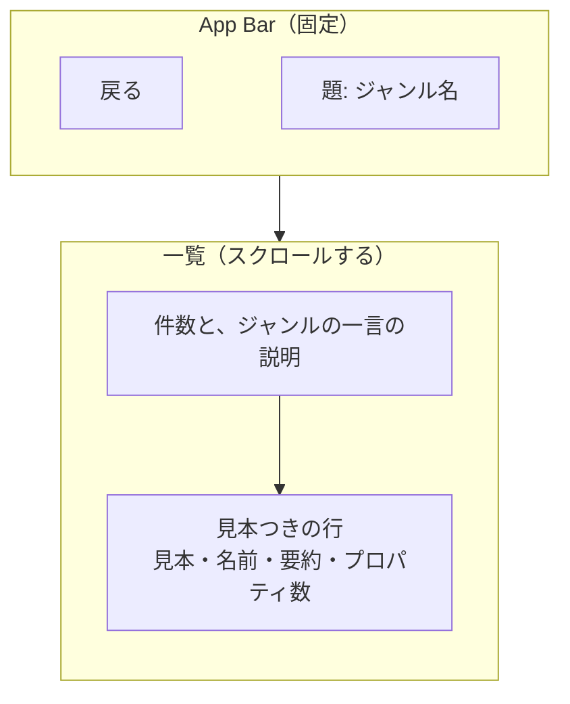
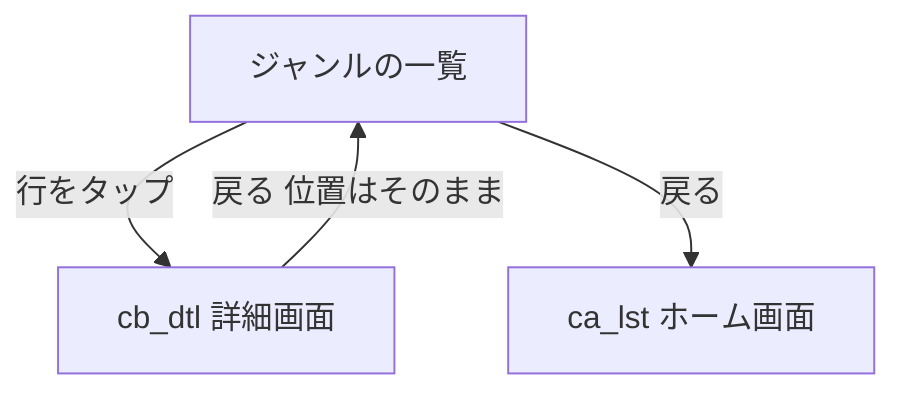

# cc_gnr ジャンル画面

> **要約**
> - 結論: 1つのジャンルの Widget を、見本（既定の見た目の縮小）つきの行で並べる
> - 影響: ホーム画面（ca_lst）のタイルから開き、行から詳細画面（cb_dtl）へ進む
> - お願い: 項目と文言の確認

## 概要

| ID | 日本語名 | 英語名 | 画面種別 | 実装種別 | 備考 |
|-|-|-|-|-|-|
| cc_gnr | ジャンル画面 | GenreScreen | スクリーン | ネイティブ | ca_lst から Push |

ジャンルを選んだ人が、その中の Widget を見本の形と名前で見比べ、触りたいものを選ぶ。

## デザイン

- ワイヤー: なし（下の mermaid の図）
- デザイン: [Figma](https://www.figma.com/design/W9DAjjGAmMzNhnCQu0BLo7/Widget-Lab?node-id=3-2)「ca_lst 候補 / 案B ジャンルの中（Basics）」。色・文字・余白は docs/design-system.md

## バージョン履歴

| 更新日 | バージョン | 更新内容 | 担当者 |
|-|-|-|-|
| 2026/10/28 | 1.0.0 | 初版作成（Figma の案B） | Claude（ui-spec） |
| 2026/10/28 | 1.0.1 | 題を左に寄せる（Figma の案B。iOS の既定は中央） | Claude（実装） |
| 2026/10/28 | 1.1.0 | 見た目を持たない Widget の見本を `account_tree` のアイコンにする | Claude（ブレインストーミング） |

## 構成

部品は Material 3 の標準（`AppBar`・`ListTile` を土台にした行）。見本は、その Widget を収録データの最初の値で組み立て、縮めて置く（絵を別に用意しない。demo-engine.md の「見本」）。

## 前の画面から受け取る値

| データ取得元 | 論理名 | 具体例 | 備考 |
|-|-|-|-|
| ca_lst | ジャンルの ID | `basics` | `String`。`Genre.id` |

## 接続先一覧

### API

| ID | API 名 | 備考 |
|-|-|-|
| | | |

### 外部接続サービス

| ID | サービス名 | 備考 |
|-|-|-|
| | | |

### ローカル DB

| テーブル名 | 備考 |
|-|-|
| | |

## 状態変化

## 基本方針

- 収録データは同梱。通信しない
- 並びは公式カタログのページの順（`lib/catalog/manifest.dart` のそのジャンルの順。1 つの Widget が複数のジャンルに入るため、`allEntries` の順では揃わない）

## 画面定義

### ab_アプリバー

#### 項目一覧

| ID | 項目名 | 内容 | 状態変化の有無 | 初期表示 | データ取得元 |
|-|-|-|-|-|-|
| ab-back | 戻る | 標準の戻るボタン | 無 | 表示 | - |
| ab-ttle | 題 | ジャンル名（例:「Basics」、title2。左に寄せる。長い名前は省略せず縮める） | 無 | 受け取ったジャンル | ローカルアセット（`genres.dart`） |

#### アクション一覧

| ID | 起動動作 | 内容（状態変化含む） |
|-|-|-|
| ab-back | タップ / 戻る操作 | `ca_lst_ホーム画面へ遷移`（Pop） |

### ls_一覧

#### 項目一覧

| ID | 項目名 | 内容 | 状態変化の有無 | 初期表示 | データ取得元 |
|-|-|-|-|-|-|
| ls-intr | 件数と説明 | 「{n} 件・{ジャンルの一言}」（subheadline、ink-secondary） | 無 | 表示 | ローカルアセット（`genres.dart`） |
| ls-item | 見本つきの行 | 左に見本（64×64、地は `surface`、角丸 `md`）。右に Widget 名（headline）、一行の要約（callout、ink-secondary、1 行で末尾を省略）、プロパティ数の印（「7 プロパティ」、caption1、地は `surface-muted`、角丸 `sm`）。右端に「›」。行の下に `outline-variant` の区切り線（見本の右から） | 無 | ジャンルの全 Widget | ローカルアセット（収録データ） |

#### アクション一覧

| ID | 起動動作 | 内容（状態変化含む） |
|-|-|-|
| ls-item | タップ | `cb_dtl_詳細画面へ遷移`（Push）。押した Widget を渡す |

#### 表示パターン

##### ls_一覧

| パターン名 | 内容 |
|-|-|
| データあり | 行を公式カタログのページの順に並べる |
| 空状態 | 該当なし（収録が 0 件のジャンルはホームにタイルを出さないため、開けない） |
| 初期表示・ローディング | 該当なし（同梱データ） |
| エラー | 該当なし。見本の組み立てが例外を出しても、その見本だけ空の枠にする（収録データの不備はテストで防ぐ） |
| オフライン | 該当なし（通信しない） |

##### ls-item_見本

| パターン名 | 内容 |
|-|-|
| 見た目を持つ Widget | 収録データの最初の値で組み立て、64×64 に収まるよう縮める（縮めるだけで拡大はしない）。見本の中は押せない |
| 見た目を持たない Widget | 組み立てず、Material Symbols の `account_tree`（outlined、24）を ink-secondary で枠の中央に出す（どれも同じアイコン）。読み上げない（行の名前と説明で足りる） |

## 文言

| 場所 | 文言 |
|-|-|
| 件数と説明 | {n} 件・{ジャンルの一言} |
| プロパティ数 | {n} プロパティ |
| ジャンルの一言 | genres.dart に置く（例: Basics「アプリの骨組みになる基本の Widget」） |

## 実装時の考慮事項

- 動的コンテンツ: Widget 名は省略しない（長い名前は折り返す。例: `AnimatedCrossFade`）。要約は 1 行で「…」
- 文字サイズの拡大: OS の設定に Flutter が合わせる。この画面で個別の対応はしない
- 性能: 見本は行が画面に入ったときだけ組み立てる（`ListView.builder`）。最大 61 件
- タブレット: 本文の最大幅を 640 にして中央に置く
- アクセシビリティ:
  - 読み上げの順は 戻る → 題 → 件数と説明 → 行
  - 見本は読み上げから外す（中の Widget の Semantics を出さない）
  - 行は「Container、色・余白・大きさ・配置をまとめて指定する箱、7 プロパティ。ボタン」と1つにまとめて読む

## 確認・調整事項

- なし
